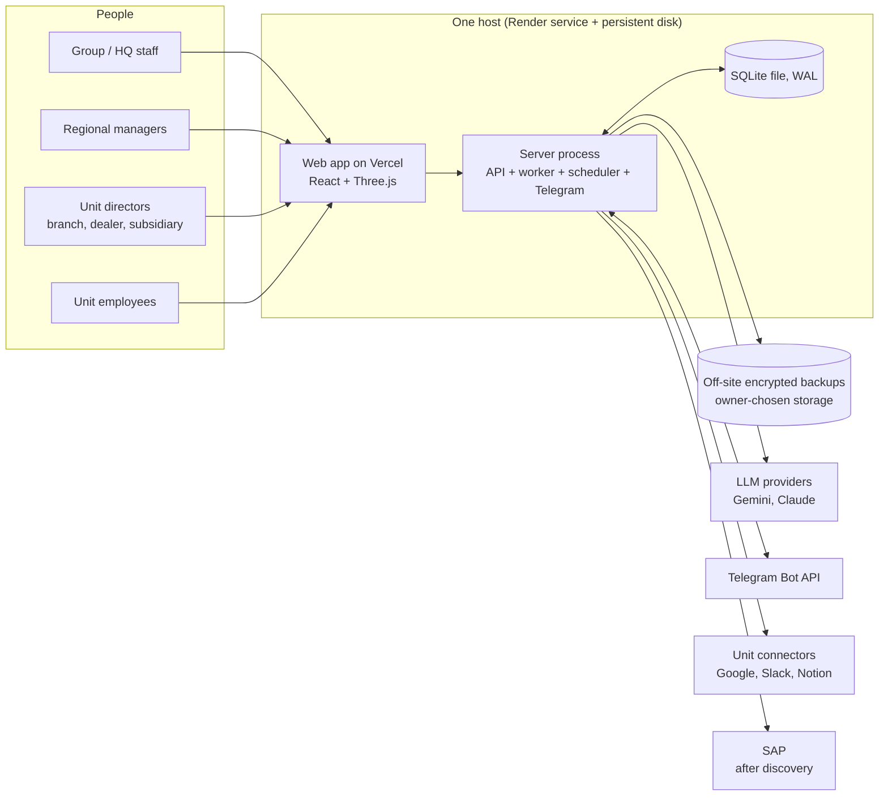
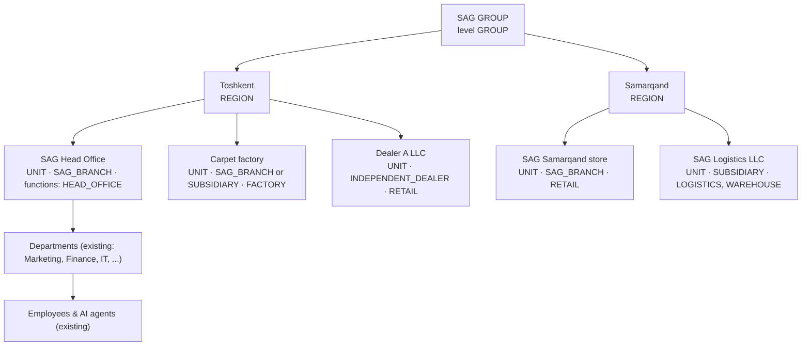
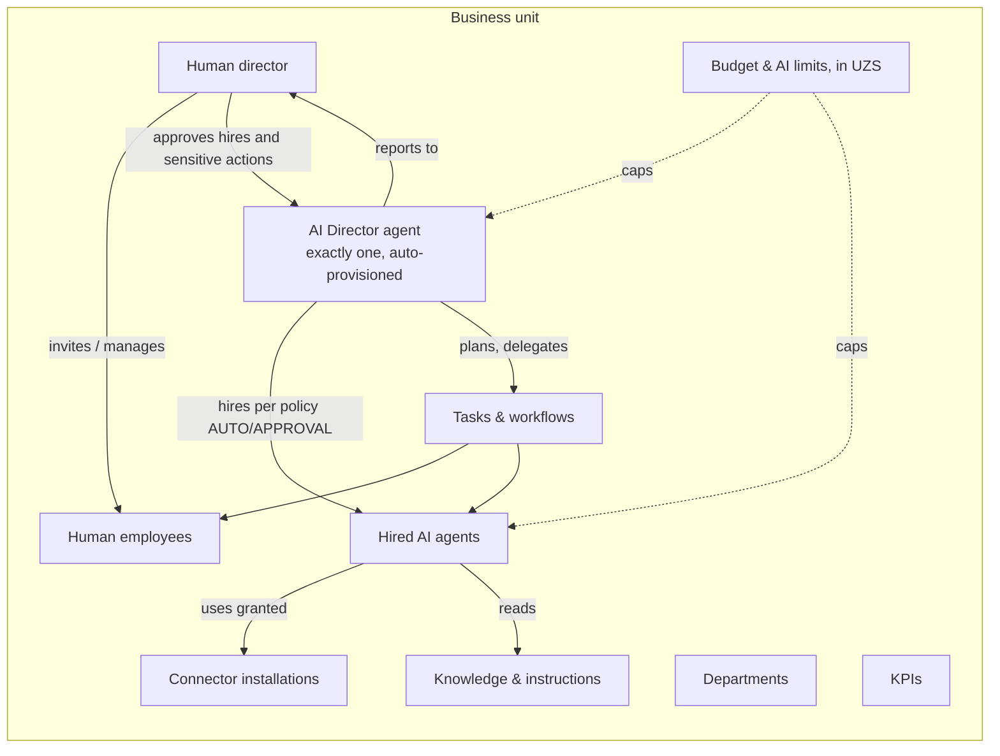
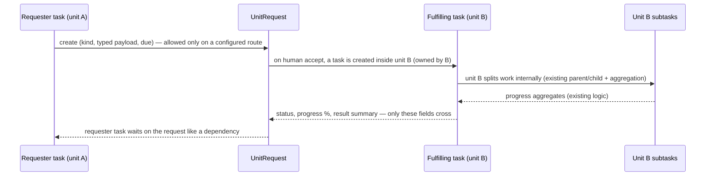

# SAG AI WORLD — Architecture

Status: **proposal, revised with the owner's decisions of 2026-10-30, awaiting review.** Nothing here is
implemented unless it says "exists today". Companion documents: [data model](SAG_WORLD_DATA_MODEL.md) ·
[security model](SAG_WORLD_SECURITY_MODEL.md) · [implementation plan](SAG_WORLD_IMPLEMENTATION_PLAN.md).

## 0. Confirmed decisions (owner, 2026-10-30)

| # | Decision | Consequence in this design |
|---|---|---|
| 1 | **SQLite stays** the database for the foreseeable future; no PostgreSQL work | single database file, single writer process; isolation enforced in the app layer + constraints + tests (no RLS); strong backup/restore |
| 2 | Business types are exactly **SAG_BRANCH**, **INDEPENDENT_DEALER**, **SUBSIDIARY** | type drives governance and default data sharing; kept separate from hierarchy and from legal ownership |
| 3 | Hierarchy **SAG GROUP → REGION → BUSINESS UNIT → DEPARTMENT → EMPLOYEE / AGENT** | one tree table for group/region/unit; existing departments, users and agents hang under units |
| 4 | **SAP** is the ERP target; no assumed connector | discovery first (product, APIs, auth, network), then an ERP port with SAP as first adapter |
| 5 | Reporting currency **UZS**; explicit currency codes; no float money | integer minor units, transaction vs reporting amounts, stored FX rates with date and source |
| 6 | Agent hiring policies **AUTO / APPROVAL / RESTRICTED**, default **APPROVAL** | policy per unit; every hire validated against template approval, permissions, caps, budget, providers, tokens, tools |

## 1. Goal and non-goals

SAG AI OFFICE today runs **one organisation** (SAG Holding HQ): departments on floors of one building, AI agents
per department, human employees, tasks, The Brain, connectors, Telegram, calendar.

SAG AI WORLD turns it into a **multi-business operating platform** for the SAG Group: branches, independent
dealers and subsidiaries, grouped by region, each with its own people, AI agents, work, knowledge, connectors and
budget, with strict data boundaries and authorised, structured channels between them.

Non-goals now: a visual "3D city" (a late presentation layer over the same data); free chat between agents;
agents that manage people; PostgreSQL; multi-region or multi-instance hosting.

## 2. Core idea

One new first-class structure, the **organisation tree** (`org_nodes`: GROUP → REGION → BUSINESS UNIT). Every
row that today belongs to "the company" gets an owning `business_unit_id`: departments, agents, tasks, knowledge,
instructions, connectors, budgets, usage, routines, approvals, events, audit. Every read and write goes through a
**scope** resolved once per request (or per agent run) and enforced in the domain layer; composite foreign keys
make cross-unit references impossible to write. Work crosses unit boundaries only as a **UnitRequest** — a typed,
audited contract between two units. What a group or region may see of a unit depends on the unit's **business
type** and on explicit **data-sharing agreements**, never on tree position alone.

## 3. System context



The server is one process today (`apps/server/src/index.ts` starts HTTP, runner, scheduler and Telegram). With
SQLite it stays **one writer process per database file** (see §10); the worker can optionally run as a second
process on the same host and disk, never on another machine.

## 4. Organisation tree



Four independent attributes describe a unit; none is derived from another:

| Attribute | Values | Answers |
|---|---|---|
| **Level / position** | GROUP (one), REGION, UNIT | where it sits in the org tree (`parent_id`) |
| **Business type** (units only) | `SAG_BRANCH`, `INDEPENDENT_DEALER`, `SUBSIDIARY` | how it is governed and what it shares by default |
| **Legal entity** | `legal_entities` row (name, TIN, group-owned or not) | who legally owns the data and signs agreements |
| **Functions** | `HEAD_OFFICE`, `RETAIL`, `WHOLESALE`, `WAREHOUSE`, `FACTORY`, `LOGISTICS`, `SERVICE` (extensible) | what it does: drives department/agent/KPI templates and request routes |

Rules:
- Exactly one GROUP. REGION parents are the GROUP. UNIT parents are a REGION. Departments belong to a UNIT
  only. (Whether a unit may sit directly under the GROUP — e.g. a group-level subsidiary not tied to a region —
  is open question Q1.)
- The current organisation migrates to: GROUP `sag-group` → REGION `toshkent` → UNIT `hq` (SAG Head Office,
  `SAG_BRANCH`, `HEAD_OFFICE`) with all existing departments, people, agents and data, unchanged.
- **Tree position grants nothing on its own.** Group and region roles see into units only as §5 and the security
  model allow.

## 5. Business types and governance

| | SAG_BRANCH | SUBSIDIARY | INDEPENDENT_DEALER |
|---|---|---|---|
| Legal entity | SAG's own entity | its own entity, group-owned | its own entity, **not** group-owned |
| Default group/region visibility | full operational read for group/region roles that hold a subtree grant | aggregates (KPIs, AI spend, request status); details only via agreement | **nothing** beyond request records both sides are party to; even aggregates need an agreement |
| Who appoints the unit director | group/region (human) | subsidiary board via group admin (human) | the dealer itself; SAG admin creates the account on the dealer's instruction |
| Knowledge from the group | inherits group policies marked "share down" | inherits marked group documents | only documents explicitly published to dealers (catalogue, price lists, brand rules) |
| Connectors | may use group installations shared down | own installations; group shared ones if allowed | own installations only |
| Budget for AI | set by the group | set by the subsidiary within group cap | set by the dealer (who pays: open question Q3) |
| Hiring policy default | APPROVAL | APPROVAL | APPROVAL |

**Data-sharing agreements** (`data_sharing_agreements`) are the only way to widen what a group/region sees of a
SUBSIDIARY or INDEPENDENT_DEALER: data classes, level (AGGREGATE or DETAIL), validity dates, signed-by, and a
reference to the contract. They are created by humans, audited, and expire.

## 6. Inside one business unit



| | Human director | AI Director agent |
|---|---|---|
| Kind | `users` row with a `unit_director` membership | `agents` row with `is_primary_director = 1` |
| Created by | an authorised human | the system, when the unit is provisioned |
| Manages people | yes, within the unit | **never** (no tool, no API path; domain functions refuse non-human actors) |
| Hires AI agents | yes (all policies) | AUTO: within limits · APPROVAL: requests only · RESTRICTED: cannot |
| Answers to | region / group per business type | its human director |

## 7. Lifecycles

### 7.1 Unit provisioning

```mermaid
stateDiagram-v2
  [*] --> PROVISIONING: authorised human creates unit (region, type, legal entity, functions, human director)
  PROVISIONING --> ACTIVE: single transaction committed
  PROVISIONING --> [*]: rolled back, nothing persists
  ACTIVE --> SUSPENDED: suspended by an authorised human
  SUSPENDED --> ACTIVE
  ACTIVE --> ARCHIVED: closed; data kept read-only, agents archived
  SUSPENDED --> ARCHIVED
```

`provisionBusinessUnit` runs in **one SQLite write transaction** (`BEGIN IMMEDIATE`, exists in `db.tx`), idempotent
by a client key:

1. Caller holds `units:create` on the target region; the region exists and is active.
2. Insert the unit (status `PROVISIONING`), its legal-entity link, functions, policy (hiring policy `APPROVAL`)
   and the budget row in UZS from templates.
3. Departments from the function templates (generated ids, not slugs).
4. Human director: existing user → `unit_director` membership; new person → invitation (account created only when
   they accept). Refused for non-human actors.
5. AI Director agent from the approved `director` template version, `is_primary_director = 1` (partial unique
   index: one per unit).
6. Default KPIs, audit `unit.provision`, status `ACTIVE`, event `unit.created`.

No LLM or network call happens inside the transaction; any failure rolls everything back.

### 7.2 Agent hiring

| Policy | Who may start a hire | Who decides |
|---|---|---|
| `AUTO` | AI Director or human director | the platform, if every check passes and the template is on the unit's pre-approved list; otherwise falls back to the human director |
| `APPROVAL` (default) | AI Director or human director | the human director, for every hire |
| `RESTRICTED` | human director only (AI Director's hire tool is not offered) | the human director |

```mermaid
sequenceDiagram
  participant AID as AI Director
  participant V as Hire validator
  participant HD as Human director
  participant SYS as Platform
  AID->>SYS: request_hire(template, department, justification) [tool; absent under RESTRICTED]
  SYS->>V: template approved & published? unit permission? max agents? budget in UZS? provider allowed? token limits? tools ⊆ template ∩ unit installations?
  alt any check fails
    V-->>AID: rejected, reason recorded
  else policy AUTO and template pre-approved
    V-->>SYS: approved (policy), recorded with the policy snapshot
    SYS->>SYS: create agent from template version
  else policy APPROVAL
    SYS->>HD: approval card (web + Telegram)
    HD-->>SYS: approve / reject (validator runs again at decision time)
  end
  SYS-->>AID: result as task event
```

Hard limits nobody but a human can change: max active agents, period AI budget, allowed providers/models,
per-agent token limits, approved templates. Additionally: a director template can only be instantiated by
provisioning; hired agents never get the hire tool; at most N pending requests per unit; cool-down after a
rejection.

### 7.3 Work across units



| Kind | Typical route | Payload |
|---|---|---|
| `assignment` | group/region → SAG_BRANCH; to SUBSIDIARY/DEALER only if their agreement allows | title, description, acceptance criteria, due |
| `stock_request` | retail unit → linked warehouse unit | lines: material number (SAP when available), quantity, unit of measure, needed-by |
| `production_availability` | factory → requester | material, available quantity, lead time, valid until |
| `transfer_request` | warehouse → logistics unit | shipment lines, pickup, drop-off, window |
| `information_request` | any → linked unit | question, needed-by |

Requests that commit stock, money or delivery need human acceptance on the receiving side; agents may draft.

## 8. Agent runtime changes

The runner (`apps/server/src/agents/runner.ts`) stays the engine:

1. **Scope per run** from the task's `business_unit_id`: instructions, knowledge, memory, departments for planning,
   connectors — all through the unit scope (today `buildSystemPrompt` uses GLOBAL instructions and the planner
   lists all departments).
2. **Orchestrator per unit**: the unit's primary director agent replaces the single global
   `ORCHESTRATOR_DEPARTMENT = "director"`; it plans only inside its unit and drafts UnitRequests for others.
3. **Budget gate** before each LLM call: per-task limits (exist) + unit period budget in UZS (AI cost recorded in
   USD micro-units and converted with the stored rate) + platform daily ceiling.
4. **Loop prevention**: task depth ≤ 4 for AI tasks, AI tasks created per unit per hour, per-unit concurrency
   slots, one planning orchestration per director at a time, request fan-out cap; plus existing one-task-per-agent,
   `MAX_SUBTASKS`, `MAX_TOOL_STEPS`, per-task limits, approval on write tools.
5. **Reliable execution** (W0.3): heartbeat leases with fencing epoch, execution records, idempotent side effects.

## 9. Module reuse map

| Existing module | Verdict | Change |
|---|---|---|
| `db/db.ts` (sync `node:sqlite`) | **keep** | add SQLITE_BUSY retry around write transactions, pre-migration backup, backup job; no async port needed |
| `lib/auth.ts`, sessions, `passwords.ts` | reuse | `AuthUser` gains memberships + scoped grants; idle timeout; no second auth system |
| `domain/access.ts` | **extend** | department scope → node/unit + department scope; business-type and agreement rules |
| `users`, `domain/employees.ts` | reuse | home unit + memberships; invitations; human-only guard |
| `departments`, `floors` | reuse | `business_unit_id`; `floor_id` optional (only HQ has 3D floors) |
| `agents`, `domain/agents.ts` | reuse | `business_unit_id`, template id/version, `is_primary_director` |
| `tasks`, `domain/tasks.ts`, `work.ts` | reuse (one task system) | `business_unit_id`, depth, request link; cross-unit only via UnitRequest |
| `agents/runner.ts`, `prompt.ts` | reuse | unit scope, unit orchestrator, budget gate, heartbeat leases |
| `connectors/*` | reuse | `connector_secrets` (one row per provider) → per-unit installations; ERP port for SAP later |
| `knowledge/*`, `domain/brain.ts` | reuse | unit ownership + explicit share-down |
| `schedule/*` | reuse | routines owned by a unit |
| `telegram/bot.ts` | reuse | one bot, many groups mapped to units |
| `lib/events.ts`, `routes/events.ts` | reuse | events carry `business_unit_id`; stream filters by scope (in-process bus is enough with one process) |
| `lib/audit.ts` | reuse | `business_unit_id` on audit rows |
| `domain/stats.ts`, `workload.ts` | reuse | per unit + permitted rollups; money in UZS minor units |
| `apps/web` campus/office | reuse for HQ | other units start with 2D views |

No duplicate user, agent, task, connector, auth or permission system.

## 10. Production architecture on SQLite

| Concern | Design |
|---|---|
| Topology | Vercel (web, proxies `/api`) → one Render web service with a persistent disk. One server process owns the DB file. Optional second **worker process on the same host and disk** (WAL allows several processes on one machine); never two machines, never a network filesystem. |
| Concurrency | WAL, `busy_timeout` (5 s today), all writes in short `BEGIN IMMEDIATE` transactions, no network or LLM calls inside a transaction, bounded retry with jitter on `SQLITE_BUSY` at transaction start. One writer at a time is the throughput ceiling; reads are concurrent. |
| Limits to respect | write rate in the low thousands of small transactions per second at best on this disk; long transactions block all writers; the synchronous API blocks the Node event loop for the query's duration, so every hot query must be indexed and paginated; large imports run in chunks. |
| Scaling path | vertical (bigger instance, faster disk), moving heavy reads (analytics) to a periodic read-only snapshot, archiving old events/usage. Revisit the database decision only if measured write latency or availability needs exceed this. |
| Availability | one instance ⇒ deploys and crashes cause short downtime; heartbeat leases + startup recovery make work resume within seconds of restart. |
| Job queue | `tasks` table + leases (exists), heartbeat + fencing epoch (W0.3). |
| Realtime | in-process EventBus + SSE replay from `task_events` (exists), scope-filtered. |
| Webhooks | Telegram (exists, secret header) and Google OAuth (state-bound); inbound webhook inbox table for idempotent processing. |
| Files | attachments/avatars as BLOBs today; acceptable at current volume, revisit size limits; included in backups. |
| Secrets | platform env (Render secrets); per-unit connector credentials AES-256-GCM with key version; backup key separate from connector key. |
| Backups | encrypted snapshots (`VACUUM INTO` → compress → AES-256-GCM) uploaded to owner-chosen storage, retention, automatic restore verification (W0.6). |
| Monitoring | structured logs with request/correlation id, readiness endpoint (DB writable, queue lag, last backup age, bot), error reporting (self-hosted log alerts by default; external service only with approval). |
| Audit | `audit_logs` (exists) + unit id, retention and export. |

## 11. SAP integration (decision 4)

No connector code until discovery answers:

| Question | Why it matters |
|---|---|
| Which product and version: S/4HANA Cloud (public/private), S/4HANA on-premise, ECC 6.0, Business One? | API surface differs completely |
| Which APIs are licensed and exposed: OData v2/v4 services (e.g. material stock, sales orders, production orders), BAPI/RFC, IDoc, SAP Business One Service Layer? | defines what `stock_request` / `production_availability` can read or write |
| Authentication: OAuth 2.0 client credentials (BTP / Cloud), basic auth with a technical user, X.509, SAP Cloud Connector? | credential storage and rotation |
| Network: is the SAP system reachable from Render (public endpoint, VPN, Cloud Connector)? | may require a relay in SAG's network |
| Which org units in SAP (company codes, plants, storage locations, sales orgs) map to our units? | unit ↔ SAP mapping table |
| Read-only first, or are any write operations wanted (create sales order, stock transfer)? | approval and idempotency design |
| Test system (sandbox/QA client) available? | we never develop against production SAP |

Architecture once answered: an **ERP port** (`ErpConnector` interface: read stock, read availability, read
documents; write operations only behind human approval and idempotency keys) with **SAP as the first adapter**;
unit ↔ SAP org mapping table; all ERP data stays owned by the unit whose SAP org it belongs to.

## 12. Money and currency (decision 5)

- Amounts are **integers in minor units** with an explicit ISO 4217 code (`amount_minor`, `currency`). UZS minor
  unit = tiyin (1/100). AI provider costs are stored as integer **USD micro-units** (today `cost_usd REAL` —
  migrated, see data model).
- Every monetary record keeps the **original transaction amount and currency**. Reports use a **reporting
  amount in UZS** computed with a stored rate: `fx_rates (base, quote, rate as scaled integer, rate_date, source)`.
  Default source: Central Bank of Uzbekistan official rate for the transaction date; the rate id is stored on the
  converted record so a report can always be reproduced.
- Rounding: half-even, applied once, at conversion; sums are of already-converted integers.
- Budgets for AI are set in UZS per unit per month; the budget gate compares UZS spend (converted per usage
  record) with the limit.

## 13. Open questions for review

1. **Q1** May a unit sit directly under SAG GROUP (no region), e.g. a group-level subsidiary?
2. **Q2** Which SAP product/version and access (see §11)? Who on SAG's side can answer?
3. **Q3** Do independent dealers pay for their own AI usage, or does SAG fund it within a cap?
4. **Q4** Should SAG_BRANCH units give region managers full operational read by default, or also via explicit
   grant only?
5. **Q5** FX source and timing: CBU daily rate on the transaction date, or month-end rate for reports?
