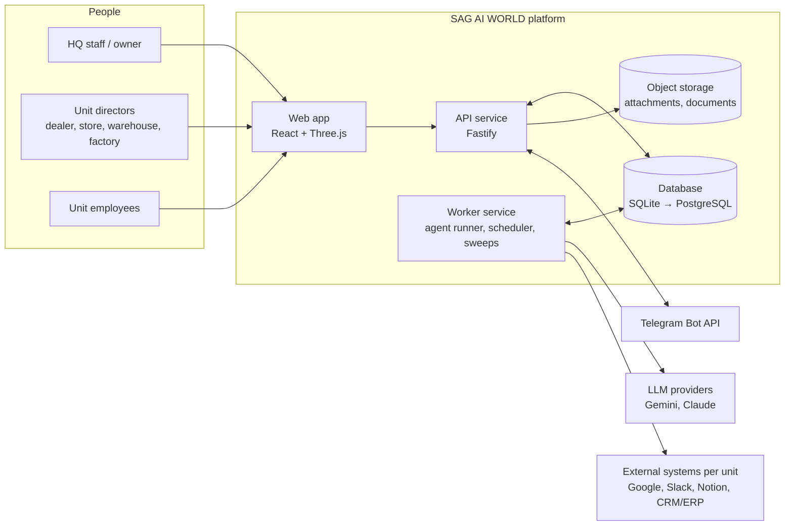
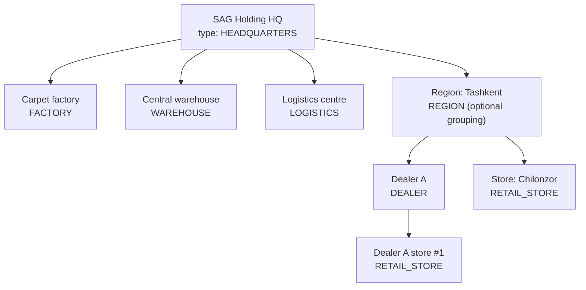
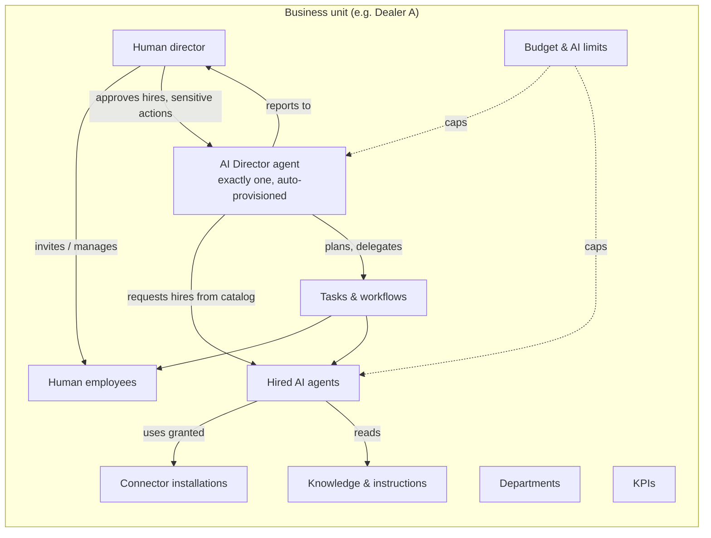
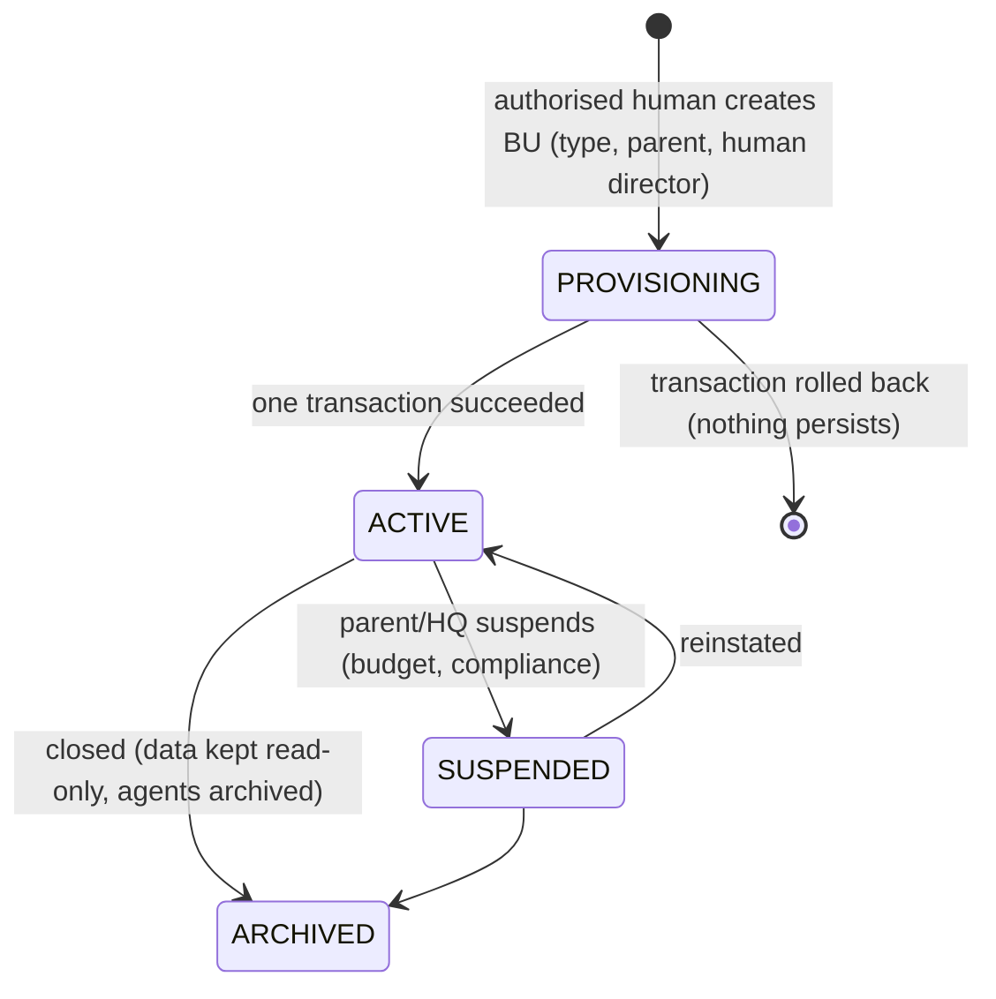
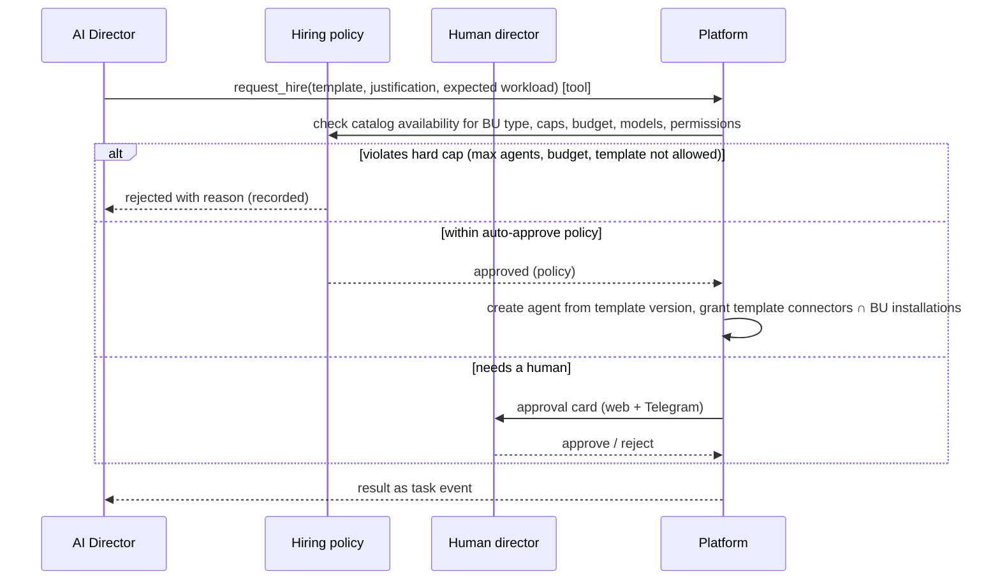
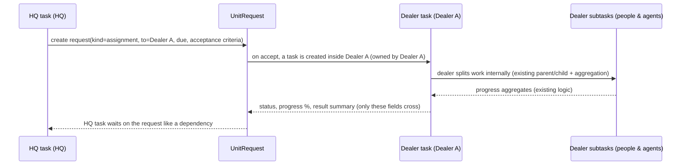

# SAG AI WORLD — Architecture

Status: **proposal, awaiting review** (2026-10-30). Nothing in this document is implemented yet unless it says
"exists today". Companion documents: [data model](SAG_WORLD_DATA_MODEL.md) · [security model](SAG_WORLD_SECURITY_MODEL.md) ·
[implementation plan](SAG_WORLD_IMPLEMENTATION_PLAN.md).

## 1. Goal and non-goals

SAG AI OFFICE today runs **one organisation** (SAG Holding HQ): departments on floors of one building, AI agents
per department, human employees, tasks, The Brain, connectors, Telegram, calendar.

SAG AI WORLD turns that into a **multi-business operating platform**: headquarters, dealers, retail stores,
warehouses, factories, logistics centres and future unit types, each running its own people, AI agents, work,
knowledge, connectors and budget, with strict data boundaries between them and authorised, structured channels
across them.

Non-goals for this stage: a visual "3D city" (the world view is a late, optional presentation layer over the
same data); a general chat between agents; agents that manage people.

## 2. Core idea in one paragraph

Introduce one new first-class entity, the **BusinessUnit (BU)**, arranged as a tree. Everything that today
belongs to "the company" gets an owning `business_unit_id`: departments, agents, tasks, knowledge, instructions,
connectors, budgets, usage, routines, approvals, events, audit. All reads and writes go through a **scope**
(the set of BUs the caller may touch for a given permission), resolved once per request and enforced in the
domain layer, with composite foreign keys that make cross-unit rows impossible to write and (after the
PostgreSQL phase) row-level security as a second line of defence. Work crosses unit boundaries only as a
**UnitRequest** — a typed, audited contract between two BUs — never as shared rows or free agent chat.

## 3. System context

API and worker are the **same codebase** with two entry points (exists today as one process: `apps/server/src/index.ts`
starts HTTP, runner, scheduler and Telegram together). Splitting them is a deployment change, not a rewrite.

## 4. Business-unit hierarchy

- Exactly one root (`HEADQUARTERS`). Every other BU has one parent. Depth is bounded (≤ 6).
- Types are rows in `business_unit_types`, not an enum in code, so a new type (e.g. `SERVICE_CENTER`) is data:
  it carries a default department template, default agent templates, default KPIs and policy defaults.
- The existing organisation becomes the root BU `hq`; its current departments, agents, people and data move
  under it unchanged (see migration, [data model §7](SAG_WORLD_DATA_MODEL.md#7-migration-from-the-current-schema)).
- Parent ≠ access. Being an ancestor gives **aggregate** visibility by default (KPIs, usage, request status), not
  raw data. Raw access to a descendant requires an explicit subtree grant ([security model §3](SAG_WORLD_SECURITY_MODEL.md#3-permission-model)).

## 5. Inside one business unit

Two identities lead a unit and they are never merged:

| | Human director | AI Director agent |
|---|---|---|
| Kind | `users` row with a BU membership role `unit_director` | `agents` row with `is_primary_director = 1` |
| Created by | an authorised human (HQ admin or parent unit director) | the system, automatically, when the BU is created |
| Can manage people | yes, within the unit | **never** (no tool, no API path, enforced on `Actor.type`) |
| Can hire AI agents | yes | may **request**; executes only within policy, else waits for the human director |
| Answers to | parent unit / HQ | its human director |

## 6. Lifecycles

### 6.1 Business unit and director provisioning

Provisioning is **one database transaction** (`provisionBusinessUnit`), idempotent by a client-supplied key:

1. Check the caller may create a child under `parent_id` (`units:create` on the parent scope) and the type is
   allowed under that parent type.
2. Insert `business_units` (status `PROVISIONING`), materialised path, policy and budget rows from type defaults.
3. Create departments from the type's department template (generated ids, not slugs).
4. Attach the **human director**: an existing active user gets a `unit_director` membership; a new person gets an
   invitation (`user_invitations`) — the account is created only when the person accepts. An AI agent can never
   call this step (Actor must be `user`).
5. Create the **AI Director agent** from the `director` template (pinned template version), in the unit's
   management department, `is_primary_director = 1` (partial unique index: exactly one per BU), with its
   default instructions and the unit's limits.
6. Seed default KPIs for the type, audit `unit.provision`, set status `ACTIVE`, emit `unit.created`.

Failure in any step rolls back everything; there is no half-created unit. Re-sending the same idempotency key
returns the existing unit.

### 6.2 Agent hiring

- Hiring creates an ordinary `agents` row (existing table) with `template_id` + `template_version`; the existing
  workstation, lifecycle, archive and transfer code keeps working.
- Hard limits (never overridable by an agent): max active agents per BU, monthly token and cost budget,
  allowed models, templates allowed for the BU type, no hiring of another director, hired agents cannot hire,
  at most N pending hire requests per BU, cool-down after a rejection.
- Auto-approve is **off** by default; a human director may enable it for specific templates under a cost ceiling.

### 6.3 Work across units

The **UnitRequest** is the only object both sides see. It carries the contract (kind, typed payload, due date,
status, progress, result summary, linked task ids) — not the fulfilling unit's internal subtasks, comments,
attachments or agent conversations. Kinds start with:

| Kind | From → To | Payload (validated by schema per kind) |
|---|---|---|
| `assignment` | parent → descendant | title, description, acceptance criteria, due |
| `stock_request` | store/dealer → warehouse | lines: SKU, quantity, needed-by; delivery address |
| `production_availability` | factory → HQ/dealer (report) | SKU/collection, available quantity, lead time, valid until |
| `transfer_request` | warehouse → logistics | shipment lines, pickup, drop-off, window |
| `information_request` | any → authorised peer | question, needed-by; answer is a result summary |

Routing rules (who may send what to whom) are data (`unit_request_routes`), e.g. "RETAIL_STORE may send
`stock_request` to the WAREHOUSE it is linked to". Requests that move money, stock or commitments require human
acceptance on the receiving side; agents may draft and propose, not accept.

## 7. Agent runtime in a multi-unit world (changes to existing code)

The current runner (`apps/server/src/agents/runner.ts`) stays the engine. Changes:

1. **Scope per run.** A claimed task carries `business_unit_id`; the runner builds a `UnitScope` once and every
   context read (instructions, knowledge, memory, department list for planning, connectors) goes through it.
   Today `buildSystemPrompt` reads `GLOBAL` instructions and the planner lists *all* departments — both become
   "this unit + inherited-down from ancestors".
2. **Orchestrator per unit.** Today `ORCHESTRATOR_DEPARTMENT = "director"` is a single global department. It
   becomes "the unit's primary director agent". The planner may only create subtasks in its own unit; to involve
   another unit it creates a UnitRequest draft (subject to routing and approval).
3. **Budget gate.** Before each LLM call, besides the existing per-task limits (`checkLimits`), check the unit's
   period budget (`unit_budgets`) and the platform-wide ceiling; exceeding pauses the unit's queue, notifies its
   human director and records why.
4. **Loop prevention.** Task depth limit (parent chain ≤ 4 for AI tasks), per-unit cap on AI tasks created per
   hour, per-unit concurrency slot cap, at most one orchestrate task in planning per director, and a request
   fan-out cap. Existing protections stay: one task per agent at a time, `MAX_SUBTASKS`, `MAX_TOOL_STEPS`,
   per-task token/cost/time/call limits, human approval on write tools.
5. **Lease correctness** (also a current bug, see plan W0): renew `lease_until` during long runs and guard every
   runner write with `lease_owner`.

## 8. Module reuse map

| Existing module | Verdict | Change |
|---|---|---|
| `db/db.ts` (sync `node:sqlite` wrapper) | reuse now, replace in P-phase | introduce an async `Db` port before PostgreSQL (see §10) |
| `lib/auth.ts`, sessions, `passwords.ts` | reuse | `AuthUser` gains memberships + scoped grants; no second auth system |
| `domain/access.ts` | **extend** (it is the right place) | department scope → unit + department scope; `visibleTaskSql` gains BU predicate |
| `users` / `domain/employees.ts` | reuse | home BU + memberships; invitations; "actor must be human" guard |
| `departments`, `floors` | reuse | departments get `business_unit_id`; `floor_id` becomes optional (non-HQ units have no 3D floors yet) |
| `agents` / `domain/agents.ts` | reuse | `business_unit_id`, `template_id/version`, `is_primary_director` |
| `tasks` / `domain/tasks.ts`, `work.ts` | reuse (one task system) | `business_unit_id`; cross-unit only via UnitRequest; depth/rate limits |
| `agents/runner.ts`, `prompt.ts` | reuse | unit scope, unit orchestrator, budget gate, lease renewal |
| `connectors/hub.ts`, `tools.ts`, `google.ts`, `secrets.ts` | reuse | `connector_secrets` (one row per provider today) → per-unit `connector_installations` |
| `knowledge/*`, `domain/brain.ts` | reuse | documents, chunks/FTS, memory, instructions get unit ownership + downward sharing |
| `schedule/*` | reuse | routines owned by a unit |
| `telegram/bot.ts` | reuse | one bot, many groups: `telegram_chats` maps a group to a unit |
| `lib/events.ts` + `routes/events.ts` (SSE) | reuse | every event carries `business_unit_id`; stream filters by scope (today AI events go to everyone) |
| `lib/audit.ts` | reuse | `business_unit_id` on audit rows; HQ audit view by scope |
| `domain/stats.ts`, `workload.ts` | reuse | per-unit, plus rollups for ancestors |
| `apps/web` campus/office scene | reuse for HQ | other units start as 2D views; a world map is a late phase |

Nothing is duplicated: there is still one user table, one agent table, one task table, one connector hub,
one auth/session system and one permission evaluator.

## 9. API boundaries

- **Unit-scoped resources** live under `/api/units/:unitId/...` (departments, agents, tasks, people, knowledge,
  connectors, routines, budget, KPIs, approvals, hire requests). The route resolves the scope for `:unitId`
  first and refuses before any query when the caller has no permission there.
- **Existing routes** (`/api/tasks`, `/api/agents`, `/api/people`, ...) keep working during migration as
  aliases for the caller's home unit, then are deprecated. The web app moves to unit-scoped routes.
- **Cross-unit resources**: `/api/unit-requests` (lists only requests where caller's unit is sender or receiver
  and caller has the permission), `/api/units` (tree filtered to what the caller may see),
  `/api/rollups/...` (aggregate-only endpoints for ancestors: KPIs, usage, request SLAs — never raw rows).
- **Agent tools** call the same domain functions with an `Actor{type:"agent"}` and the run's `UnitScope`;
  there is no separate "agent API" with weaker checks.
- **Public endpoints** stay minimal: health, login, logout, OAuth callback (state-bound), Telegram webhook
  (secret header).

## 10. Production architecture

| Concern | Today | Target |
|---|---|---|
| Database | SQLite file on a Render disk, single instance, WAL | **PostgreSQL** (managed), RLS on unit-owned tables, PITR backups |
| DB access | synchronous `DatabaseSync` everywhere | async `Db` port with two adapters (SQLite for dev/tests, Postgres for prod); all domain functions `async` |
| Migrations | ordered `.sql`, transactional, FK check | same runner, dialect-specific files where needed; pre-migration backup; tested on a copy of prod |
| Job queue | `tasks` table leases, in-process timers | same table, `SELECT ... FOR UPDATE SKIP LOCKED`, lease renewal, separate worker service |
| Realtime | in-process EventBus + SSE replay from `task_events` | `task_events` stays the log; cross-instance fan-out via Postgres `LISTEN/NOTIFY`; scope-filtered streams |
| Webhooks | Telegram webhook with secret; Google callback | same, plus an inbox table (store, then process idempotently) for every external webhook |
| Files | BLOBs in the DB (attachments, avatars) | object storage (S3-compatible), DB keeps metadata + key; signed, short-lived download URLs |
| Secrets | `.env`, AES-GCM `SECRETS_KEY` for connector tokens | platform secret manager for env; per-unit connector credentials encrypted with a key-encryption key, key versioning |
| Topology | Vercel (web) + 1 Render service | Vercel web → API (≥2 instances) + worker (1–N) + managed Postgres + object storage |
| Monitoring | logs, `/api/health` (no DB check) | structured logs with request/correlation id, readiness check (DB, queue lag), error tracking, alerts on queue lag, budget, failed runs |
| Audit | `audit_logs` (good coverage) | + `business_unit_id`, retention policy, export, append-only in Postgres |

Recommendation on timing: build the BU model on the current SQLite stack first (it is portable SQL and the test
suite is fast), but **complete the PostgreSQL phase before the first external dealer or store gets accounts**.
External tenants are where cross-unit leakage stops being theoretical, and RLS is the second line of defence we
want in place by then.

## 11. Open questions for review

1. Are dealers separate legal companies (external accounts, their own connectors) or SAG-owned branches? This
   decides default visibility of HQ into dealer data (aggregate-only vs. full).
2. Is a `REGION` grouping unit wanted, or is the tree HQ → units directly?
3. Which system is the source of truth for stock and production (1C, SAP, a spreadsheet)? `stock_request` and
   `production_availability` should read from it through a connector rather than invent numbers.
4. Budget currency and period: USD per month per unit, with HQ able to move budget between units?
5. Should a unit's human director be able to enable auto-approve for hires at all, or always approve manually?
