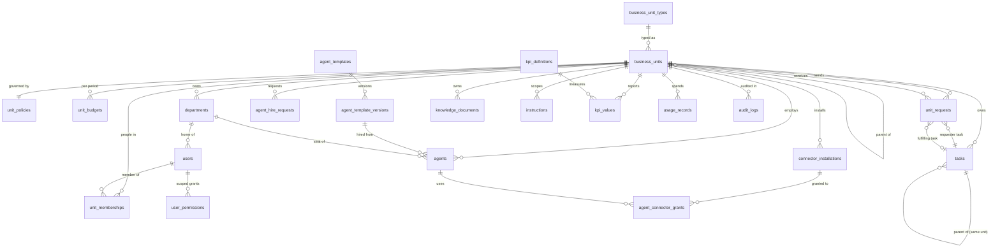

# SAG AI WORLD — Data model

Status: **proposal, awaiting review**. Builds on the current schema in
`apps/server/src/db/migrations/001–009`. Conventions stay as today: TEXT ids (`uid(prefix)`), ISO-8601 TEXT
timestamps, JSON as TEXT, portable SQL (SQLite now, PostgreSQL later).

## 1. Principles

1. **One owner column.** Every unit-owned row has `business_unit_id NOT NULL`. It is denormalised on purpose
   (also on rows that could derive it through a department) so every scoped query and every future RLS policy is
   a single-column predicate with an index.
2. **Consistency by foreign key, not by hope.** Where a row references a department or agent, the reference is a
   *composite* foreign key `(department_id, business_unit_id) → departments(id, business_unit_id)`. A task cannot
   point at a department of another unit, because the database refuses the row.
3. **Cross-unit data has its own table.** The only rows two units both see are `unit_requests` (and their event
   log). No table has "two owners".
4. **Extend, don't fork.** New columns on existing tables; new tables only for new concepts (units, memberships,
   templates, budgets, KPIs, requests, installations).
5. **Generated ids for new rows.** Existing slug ids (`marketing`, `marketing-javohir`) stay for HQ; every unit
   gets departments like `dep_…`, so two units can each have a "Sales" department.

## 2. Entity relationships



## 3. New tables

### 3.1 Units

```sql
CREATE TABLE business_unit_types (
  id                 TEXT PRIMARY KEY,          -- 'HEADQUARTERS','REGION','DEALER','RETAIL_STORE','WAREHOUSE','FACTORY','LOGISTICS'
  name               TEXT NOT NULL,
  allowed_parents    TEXT NOT NULL DEFAULT '[]', -- JSON array of type ids
  department_template TEXT NOT NULL DEFAULT '[]',-- JSON: [{key,name,short,color,focus[]}]
  default_agent_templates TEXT NOT NULL DEFAULT '[]',
  default_kpis       TEXT NOT NULL DEFAULT '[]',
  default_policy     TEXT NOT NULL DEFAULT '{}',
  is_active          INTEGER NOT NULL DEFAULT 1
);

CREATE TABLE business_units (
  id               TEXT PRIMARY KEY,             -- 'hq' for the existing organisation, 'bu_…' afterwards
  type_id          TEXT NOT NULL REFERENCES business_unit_types(id),
  parent_id        TEXT REFERENCES business_units(id),
  path             TEXT NOT NULL,                -- materialised path '/hq/bu_r1/bu_d1/' for subtree queries
  depth            INTEGER NOT NULL CHECK (depth BETWEEN 0 AND 6),
  code             TEXT NOT NULL UNIQUE,         -- short human code, e.g. 'TAS-D01'
  name             TEXT NOT NULL,
  legal_name       TEXT,
  is_external      INTEGER NOT NULL DEFAULT 0,   -- separate legal entity (dealer) → stricter defaults
  status           TEXT NOT NULL DEFAULT 'PROVISIONING'
                     CHECK (status IN ('PROVISIONING','ACTIVE','SUSPENDED','ARCHIVED')),
  timezone         TEXT NOT NULL DEFAULT 'Asia/Tashkent',
  address          TEXT,
  geo              TEXT,                         -- JSON {lat,lng}, for the future world map
  human_director_user_id TEXT REFERENCES users(id),
  provision_key    TEXT UNIQUE,                  -- idempotency key of the create call
  created_by       TEXT REFERENCES users(id),
  created_at       TEXT NOT NULL,
  updated_at       TEXT NOT NULL,
  archived_at      TEXT,
  CHECK ((parent_id IS NULL) = (depth = 0))
);
-- exactly one root: enforced by a BEFORE INSERT/UPDATE trigger (SQLite) / partial unique index on a constant (PostgreSQL)
CREATE INDEX idx_bu_parent ON business_units(parent_id, status);
CREATE INDEX idx_bu_path ON business_units(path);

CREATE TABLE unit_policies (
  business_unit_id      TEXT PRIMARY KEY REFERENCES business_units(id) ON DELETE CASCADE,
  max_active_agents     INTEGER NOT NULL DEFAULT 6 CHECK (max_active_agents BETWEEN 1 AND 100),
  max_concurrent_runs   INTEGER NOT NULL DEFAULT 2,
  max_ai_tasks_per_hour INTEGER NOT NULL DEFAULT 30,
  max_task_depth        INTEGER NOT NULL DEFAULT 4,
  allowed_models        TEXT NOT NULL DEFAULT '[]',      -- empty = platform default only
  allowed_templates     TEXT NOT NULL DEFAULT '[]',      -- template ids; ∩ type allowance
  auto_approve_hires    TEXT NOT NULL DEFAULT '[]',      -- template ids a director pre-approved
  auto_approve_max_monthly_usd REAL NOT NULL DEFAULT 0,
  max_pending_hire_requests INTEGER NOT NULL DEFAULT 3,
  updated_by            TEXT REFERENCES users(id),
  updated_at            TEXT NOT NULL
);

CREATE TABLE unit_budgets (
  id               TEXT PRIMARY KEY,
  business_unit_id TEXT NOT NULL REFERENCES business_units(id) ON DELETE CASCADE,
  period           TEXT NOT NULL,                -- '2026-11' (month, unit timezone)
  token_limit      INTEGER,                      -- NULL = no token cap
  cost_limit_usd   REAL NOT NULL,
  on_exhausted     TEXT NOT NULL DEFAULT 'PAUSE' CHECK (on_exhausted IN ('PAUSE','NOTIFY_ONLY')),
  set_by           TEXT REFERENCES users(id),
  created_at       TEXT NOT NULL,
  UNIQUE (business_unit_id, period)
);
```

Spend is not stored twice: it is `SUM(usage_records.cost_usd)` for the unit and period (index below). A cached
counter is added only if measurements show the query matters.

### 3.2 People in units

```sql
CREATE TABLE unit_memberships (
  user_id          TEXT NOT NULL REFERENCES users(id) ON DELETE CASCADE,
  business_unit_id TEXT NOT NULL REFERENCES business_units(id) ON DELETE CASCADE,
  role_id          TEXT NOT NULL REFERENCES roles(id),   -- 'unit_director','department_head','employee','viewer',...
  include_descendants INTEGER NOT NULL DEFAULT 0,        -- role applies to the subtree (e.g. regional manager)
  granted_by       TEXT NOT NULL REFERENCES users(id),   -- always a human
  granted_at       TEXT NOT NULL,
  PRIMARY KEY (user_id, business_unit_id, role_id)
);
CREATE INDEX idx_membership_unit ON unit_memberships(business_unit_id, role_id);

CREATE TABLE user_invitations (
  id               TEXT PRIMARY KEY,
  business_unit_id TEXT NOT NULL REFERENCES business_units(id),
  email            TEXT NOT NULL,
  role_id          TEXT NOT NULL REFERENCES roles(id),
  department_id    TEXT,
  token_hash       TEXT NOT NULL UNIQUE,                 -- raw token only in the invite link
  invited_by       TEXT NOT NULL REFERENCES users(id),   -- always a human
  expires_at       TEXT NOT NULL,
  accepted_user_id TEXT REFERENCES users(id),
  accepted_at      TEXT,
  revoked_at       TEXT,
  created_at       TEXT NOT NULL
);
```

`user_roles` (global) stays only for **platform roles** (`platform_admin`). Unit roles move to memberships.
`user_permissions` (exists, migration 007) is generalised: `department_id` stays, `business_unit_id` and
`include_descendants` are added, so one grant table covers department, unit and subtree scope.

### 3.3 Agent marketplace

```sql
CREATE TABLE agent_templates (
  id          TEXT PRIMARY KEY,            -- 'director','sales','marketing','finance','hr','inventory',
                                           -- 'procurement','support','logistics','analyst'
  name        TEXT NOT NULL,
  category    TEXT NOT NULL,
  is_director INTEGER NOT NULL DEFAULT 0,  -- only the provisioning step may instantiate these
  allowed_unit_types TEXT NOT NULL DEFAULT '[]',
  status      TEXT NOT NULL DEFAULT 'ACTIVE' CHECK (status IN ('DRAFT','ACTIVE','RETIRED')),
  created_at  TEXT NOT NULL
);

CREATE TABLE agent_template_versions (
  template_id       TEXT NOT NULL REFERENCES agent_templates(id),
  version           INTEGER NOT NULL,
  role              TEXT NOT NULL,
  responsibilities  TEXT NOT NULL,
  skills            TEXT NOT NULL DEFAULT '[]',
  instructions      TEXT NOT NULL,          -- becomes the agent's AGENT-scope instruction v1
  tools             TEXT NOT NULL DEFAULT '[]',  -- tool names the template may ever be granted
  default_model     TEXT,
  allowed_models    TEXT NOT NULL DEFAULT '[]',
  default_limits    TEXT NOT NULL DEFAULT '{}',  -- TaskLimits (exists in shared types)
  est_monthly_usd   REAL NOT NULL DEFAULT 0,
  risk_level        TEXT NOT NULL DEFAULT 'LOW' CHECK (risk_level IN ('LOW','MEDIUM','HIGH')),
  published_by      TEXT REFERENCES users(id),
  published_at      TEXT NOT NULL,
  PRIMARY KEY (template_id, version)
);

CREATE TABLE agent_hire_requests (
  id               TEXT PRIMARY KEY,
  business_unit_id TEXT NOT NULL REFERENCES business_units(id),
  template_id      TEXT NOT NULL,
  template_version INTEGER NOT NULL,
  department_id    TEXT NOT NULL,
  requested_by_type TEXT NOT NULL CHECK (requested_by_type IN ('user','agent')),
  requested_by_id  TEXT NOT NULL,
  justification    TEXT NOT NULL,
  est_monthly_usd  REAL NOT NULL,
  status           TEXT NOT NULL DEFAULT 'PENDING'
                     CHECK (status IN ('PENDING','APPROVED','REJECTED','CANCELLED','EXPIRED')),
  decided_by       TEXT REFERENCES users(id),     -- NULL only when decided_via = 'policy'
  decided_via      TEXT CHECK (decided_via IN ('user','policy')),
  decision_reason  TEXT,
  agent_id         TEXT REFERENCES agents(id),    -- the hired agent
  created_at       TEXT NOT NULL,
  decided_at       TEXT,
  FOREIGN KEY (template_id, template_version) REFERENCES agent_template_versions(template_id, version),
  FOREIGN KEY (department_id, business_unit_id) REFERENCES departments(id, business_unit_id)
);
CREATE INDEX idx_hire_unit ON agent_hire_requests(business_unit_id, status);
```

### 3.4 Cross-unit work

```sql
CREATE TABLE unit_request_routes (          -- who may send what to whom (data, editable by HQ)
  id             TEXT PRIMARY KEY,
  kind           TEXT NOT NULL,
  from_type_id   TEXT NOT NULL REFERENCES business_unit_types(id),
  to_type_id     TEXT NOT NULL REFERENCES business_unit_types(id),
  relation       TEXT NOT NULL CHECK (relation IN ('DESCENDANT','ANCESTOR','LINKED','ANY_AUTHORISED')),
  requires_human_accept INTEGER NOT NULL DEFAULT 1,
  UNIQUE (kind, from_type_id, to_type_id)
);

CREATE TABLE unit_links (                   -- explicit relations outside the tree (store ↔ its warehouse)
  from_unit_id TEXT NOT NULL REFERENCES business_units(id) ON DELETE CASCADE,
  to_unit_id   TEXT NOT NULL REFERENCES business_units(id) ON DELETE CASCADE,
  relation     TEXT NOT NULL,               -- 'SUPPLIED_BY','SHIPS_VIA'
  PRIMARY KEY (from_unit_id, to_unit_id, relation)
);

CREATE TABLE unit_requests (
  id                 TEXT PRIMARY KEY,
  kind               TEXT NOT NULL,           -- 'assignment','stock_request','production_availability',...
  from_unit_id       TEXT NOT NULL REFERENCES business_units(id),
  to_unit_id         TEXT NOT NULL REFERENCES business_units(id),
  title              TEXT NOT NULL,
  payload            TEXT NOT NULL,           -- validated by the kind's zod schema
  due_at             TEXT,
  priority           TEXT NOT NULL DEFAULT 'MEDIUM',
  status             TEXT NOT NULL DEFAULT 'DRAFT' CHECK (status IN
                       ('DRAFT','SENT','ACCEPTED','DECLINED','IN_PROGRESS','FULFILLED','PARTIAL','CANCELLED','EXPIRED')),
  progress           INTEGER CHECK (progress IS NULL OR progress BETWEEN 0 AND 100),
  result_summary     TEXT,                    -- the only result text that crosses the boundary
  requester_task_id  TEXT,                    -- task in from_unit (waits on this request)
  fulfiller_task_id  TEXT,                    -- task in to_unit, created on accept
  created_by_type    TEXT NOT NULL CHECK (created_by_type IN ('user','agent','system')),
  created_by_id      TEXT,
  sent_by            TEXT REFERENCES users(id),   -- sending needs a human unless the route allows agents
  accepted_by        TEXT REFERENCES users(id),
  idempotency_key    TEXT UNIQUE,
  created_at         TEXT NOT NULL,
  updated_at         TEXT NOT NULL,
  CHECK (from_unit_id <> to_unit_id),
  FOREIGN KEY (requester_task_id, from_unit_id) REFERENCES tasks(id, business_unit_id),
  FOREIGN KEY (fulfiller_task_id, to_unit_id)   REFERENCES tasks(id, business_unit_id)
);
CREATE INDEX idx_ureq_to ON unit_requests(to_unit_id, status);
CREATE INDEX idx_ureq_from ON unit_requests(from_unit_id, status);

CREATE TABLE unit_request_events (          -- both sides' shared timeline (status changes, notes)
  id          INTEGER PRIMARY KEY AUTOINCREMENT,
  request_id  TEXT NOT NULL REFERENCES unit_requests(id) ON DELETE CASCADE,
  type        TEXT NOT NULL,
  actor_type  TEXT NOT NULL,
  actor_id    TEXT,
  data        TEXT NOT NULL DEFAULT '{}',
  created_at  TEXT NOT NULL
);
```

The composite FKs make it impossible to link a requester task that is not in `from_unit_id`, or a fulfilling
task that is not in `to_unit_id`.

### 3.5 Connectors, KPIs

```sql
CREATE TABLE connector_installations (      -- replaces connector_secrets (one row per provider today)
  id               TEXT PRIMARY KEY,
  business_unit_id TEXT NOT NULL REFERENCES business_units(id) ON DELETE CASCADE,
  connector_id     TEXT NOT NULL REFERENCES connectors(id),   -- catalog entry (exists)
  status           TEXT NOT NULL DEFAULT 'disconnected',
  account          TEXT,
  scopes           TEXT NOT NULL DEFAULT '[]',
  ciphertext       BLOB, iv BLOB, tag BLOB,
  key_version      INTEGER NOT NULL DEFAULT 1,
  share_with_descendants INTEGER NOT NULL DEFAULT 0,          -- e.g. HQ read-only catalogue drive
  updated_by       TEXT REFERENCES users(id),
  updated_at       TEXT NOT NULL,
  UNIQUE (business_unit_id, connector_id)
);

CREATE TABLE kpi_definitions (
  id          TEXT PRIMARY KEY,               -- 'monthly_sales_uzs','stock_turnover','on_time_delivery_pct'
  name        TEXT NOT NULL,
  unit        TEXT NOT NULL,                  -- 'UZS','%','pcs','m2'
  direction   TEXT NOT NULL CHECK (direction IN ('UP','DOWN')),
  rollup      TEXT NOT NULL CHECK (rollup IN ('SUM','AVG','WEIGHTED_AVG','MIN','MAX','NONE')),
  unit_types  TEXT NOT NULL DEFAULT '[]'
);

CREATE TABLE kpi_values (
  id               TEXT PRIMARY KEY,
  business_unit_id TEXT NOT NULL REFERENCES business_units(id),
  kpi_id           TEXT NOT NULL REFERENCES kpi_definitions(id),
  period           TEXT NOT NULL,             -- '2026-11' or '2026-W45'
  value            REAL NOT NULL,
  target           REAL,
  source           TEXT NOT NULL CHECK (source IN ('manual','connector','agent_proposed')),
  status           TEXT NOT NULL DEFAULT 'CONFIRMED' CHECK (status IN ('PROPOSED','CONFIRMED','REJECTED')),
  recorded_by_type TEXT NOT NULL, recorded_by_id TEXT,
  confirmed_by     TEXT REFERENCES users(id),
  created_at       TEXT NOT NULL,
  UNIQUE (business_unit_id, kpi_id, period, source)
);
```

Agent-reported KPI values are `PROPOSED` until a person confirms them; rollups to ancestors use confirmed values.

## 4. Changes to existing tables

| Table | Change |
|---|---|
| `departments` | + `business_unit_id NOT NULL`; `floor_id` nullable; `UNIQUE (id, business_unit_id)` for composite FKs; `head_user_id` stays |
| `users` | + `home_business_unit_id`; `department_id` stays (home department) |
| `agents` | + `business_unit_id NOT NULL`, `template_id`, `template_version`, `is_primary_director`; composite FK to departments; `UNIQUE INDEX (business_unit_id) WHERE is_primary_director = 1 AND lifecycle <> 'ARCHIVED'` |
| `tasks` | + `business_unit_id NOT NULL`, `depth INTEGER NOT NULL DEFAULT 0`, `unit_request_id`; `UNIQUE (id, business_unit_id)`; composite FKs to departments/agents; a CHECK-equivalent trigger: `parent_id` must be in the same unit |
| `instructions` | scope gains `'BUSINESS_UNIT'`; `GLOBAL` becomes "platform rules" (HQ only, inherited by all); + `business_unit_id` (NULL only for GLOBAL); + `inherit_down` |
| `knowledge_documents`, `knowledge_chunks`, `knowledge_fts`, `knowledge_embeddings` | + `business_unit_id` + `visibility ('UNIT','UNIT_AND_DESCENDANTS')` on documents; FTS gets an UNINDEXED `business_unit_id` column |
| `company_memory` | + `business_unit_id` (renamed concept: unit memory; HQ memory may be `inherit_down`) |
| `approvals`, `agent_runs`, `tool_executions`, `usage_records`, `deliverables`, `agent_messages`, `chat_messages` | + `business_unit_id NOT NULL` (copied from the task/agent at insert) |
| `routines`, `routine_runs` | + `business_unit_id` |
| `task_events` | + `business_unit_id` (stream filtering); `unit_request_events` for cross-unit |
| `audit_logs` | + `business_unit_id` (NULL = platform-level) |
| `notifications` | unchanged (user-addressed) + `business_unit_id` for filtering |
| `connector_secrets`, `department_connectors` | migrated into `connector_installations` (HQ), then dropped |
| `agent_connector_permissions` | becomes `agent_connector_grants (agent_id, installation_id, allowed_actions)`; composite check that both are in the same unit (or installation shared down to it) |
| `telegram_task_links`, new `telegram_chats` | `telegram_chats (chat_id PK, business_unit_id, kind)` maps groups to units |

New indexes: `(business_unit_id, status)` on tasks, agents, approvals; `(business_unit_id, created_at)` on
usage_records, audit_logs, task_events.

## 5. Scoped query pattern (domain layer)

```ts
// resolved once per request / per agent run; immutable
interface UnitScope {
  actor: Actor;                       // user | agent | system
  units(p: Permission): string[];     // unit ids where p applies (direct + subtree grants)
  inheritedFrom(unitId: string): string[]; // ancestors whose inherit_down content is visible
}

// every list/get on a unit-owned table takes the scope, never a bare ctx
listTasks(ctx, scope, { unitId, ... })  // SQL: WHERE t.business_unit_id IN (scope.units('tasks:read')) AND ...
```

A test helper walks every exported domain function that touches a unit-owned table and fails when it can be
called without a scope (see security model §6).

## 6. Hierarchy queries

- Subtree: `SELECT id FROM business_units WHERE path LIKE :path || '%'` (indexed prefix in SQLite with
  `COLLATE BINARY`; `text_pattern_ops` in PostgreSQL). Path is rewritten only on move (rare, audited, in one tx).
- Ancestors: split the path. Depth ≤ 6 keeps both cheap; no recursive CTE on hot paths.

## 7. Migration from the current schema

Migration `010_business_units.sql` (and following, one concern each), **zero behaviour change for HQ**:

1. Create `business_unit_types` with the types above and `business_units` row `hq` (type `HEADQUARTERS`,
   path `/hq/`, status `ACTIVE`, human director = the current user with role `director`, if any).
2. Add `business_unit_id` to every table in §4 with `DEFAULT 'hq'`, backfill `'hq'`.
3. Rebuild the tables whose FKs/NOT NULL change (SQLite cannot alter constraints) with the
   `-- migrate: foreign_keys=off` pattern already used in `007_people_workflow.sql`, then `PRAGMA foreign_key_check`
   (already enforced by the migration runner).
4. Copy `connector_secrets` → `connector_installations` (unit `hq`, same ciphertext/iv/tag, `key_version` 1),
   `department_connectors` + `agent_connector_permissions` → grants. Keep the old tables one release, read-only,
   then drop in a later migration.
5. Mark the existing `director` department's lead agent as `is_primary_director = 1` for `hq`.
6. Map global roles to memberships in `hq`: `director` → `unit_director`, `department_head`, `employee`, `hr`,
   `member`, `viewer` → same role in `hq`; `admin` → `platform_admin` (global).

Verification (automated test on a copy of the current dev DB and on a fresh DB): row counts per table equal
before/after; every unit-owned row has `business_unit_id = 'hq'`; the full existing test suite passes unchanged;
`PRAGMA foreign_key_check` is empty.

Rollback: restore the pre-migration backup (`VACUUM INTO` taken automatically by the migration runner before
any pending migration, see implementation plan W0). Migrations stay forward-only; there are no "down" scripts
for data-reshaping steps.
