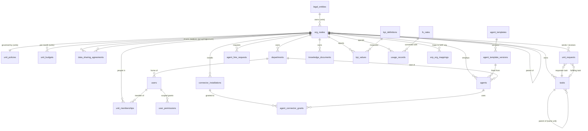

# SAG AI WORLD — Data model

Status: **proposal, revised with the owner's decisions of 2026-10-30, awaiting review.** Builds on
`apps/server/src/db/migrations/001–009`. **SQLite only** (decision 1). Conventions stay: TEXT ids (`uid(prefix)`),
ISO-8601 TEXT timestamps, JSON as TEXT; new: money as INTEGER minor units with a currency code.

## 1. Principles

1. **One owner column.** Every unit-owned row has `business_unit_id NOT NULL`, denormalised on purpose so every
   scoped query is a single indexed predicate.
2. **Consistency by foreign key.** References to departments, agents and tasks are *composite* foreign keys
   `(x_id, business_unit_id) → x(id, business_unit_id)`; SQLite enforces them (`PRAGMA foreign_keys = ON`, exists).
   A task cannot point at another unit's department because the database refuses the row.
3. **Cross-unit data has its own tables** (`unit_requests`, `unit_request_events`, `data_sharing_agreements`).
4. **Extend, don't fork** existing tables; new tables only for new concepts.
5. **Generated ids for new rows**; existing slug ids (`marketing`, `marketing-javohir`) stay for HQ.
6. **No floating-point money.** Integer minor units + ISO 4217 code; FX rates as scaled integers.
7. **SQLite-aware**: constraints SQLite can enforce (CHECK, partial unique indexes, composite FKs, triggers for
   rules that need a lookup); short write transactions; indexes for every scoped list query.

## 2. Entity relationships



## 3. New tables

### 3.1 Organisation tree, legal entities, sharing

```sql
CREATE TABLE legal_entities (
  id           TEXT PRIMARY KEY,
  name         TEXT NOT NULL,
  tin          TEXT UNIQUE,                       -- taxpayer id (STIR)
  country      TEXT NOT NULL DEFAULT 'UZ',
  group_owned  INTEGER NOT NULL CHECK (group_owned IN (0, 1)),
  created_at   TEXT NOT NULL
);

CREATE TABLE org_nodes (
  id               TEXT PRIMARY KEY,              -- 'sag-group', 'toshkent', 'hq', then 'bu_…' / 'rg_…'
  level            TEXT NOT NULL CHECK (level IN ('GROUP','REGION','UNIT')),
  parent_id        TEXT REFERENCES org_nodes(id),
  path             TEXT NOT NULL,                 -- '/sag-group/toshkent/hq/' (subtree = prefix match)
  name             TEXT NOT NULL,
  code             TEXT NOT NULL UNIQUE,
  -- units only
  business_type    TEXT CHECK (business_type IN ('SAG_BRANCH','INDEPENDENT_DEALER','SUBSIDIARY')),
  legal_entity_id  TEXT REFERENCES legal_entities(id),
  functions        TEXT NOT NULL DEFAULT '[]',    -- JSON: ['HEAD_OFFICE','RETAIL','WAREHOUSE','FACTORY','LOGISTICS',...]
  status           TEXT NOT NULL DEFAULT 'ACTIVE' CHECK (status IN ('PROVISIONING','ACTIVE','SUSPENDED','ARCHIVED')),
  timezone         TEXT NOT NULL DEFAULT 'Asia/Tashkent',
  reporting_currency TEXT NOT NULL DEFAULT 'UZS',
  address          TEXT,
  geo              TEXT,                          -- JSON {lat,lng}
  human_director_user_id TEXT REFERENCES users(id),
  provision_key    TEXT UNIQUE,
  created_by       TEXT REFERENCES users(id),
  created_at       TEXT NOT NULL,
  updated_at       TEXT NOT NULL,
  -- shape rules SQLite can check on the row itself
  CHECK ((level = 'GROUP') = (parent_id IS NULL)),
  CHECK ((level = 'UNIT') = (business_type IS NOT NULL)),
  CHECK (level <> 'UNIT' OR legal_entity_id IS NOT NULL)
);
CREATE INDEX idx_org_parent ON org_nodes(parent_id, status);
CREATE INDEX idx_org_path ON org_nodes(path);
CREATE UNIQUE INDEX ux_org_single_group ON org_nodes(level) WHERE level = 'GROUP';
-- parent-level rules (REGION under GROUP, UNIT under REGION) need a lookup → BEFORE INSERT/UPDATE triggers.
-- business type vs legal entity: SAG_BRANCH ⇒ entity is SAG's own; SUBSIDIARY ⇒ group_owned = 1 and not SAG's own
-- entity; INDEPENDENT_DEALER ⇒ group_owned = 0 (trigger).
```

`business_unit_id` columns elsewhere reference `org_nodes(id)`; a trigger refuses ids whose level is not `UNIT`
(departments, agents and tasks exist only in units).

```sql
CREATE TABLE data_sharing_agreements (
  id               TEXT PRIMARY KEY,
  unit_id          TEXT NOT NULL REFERENCES org_nodes(id),     -- the data owner (a UNIT)
  grantee_node_id  TEXT NOT NULL REFERENCES org_nodes(id),     -- GROUP, REGION or another UNIT
  data_classes     TEXT NOT NULL,                              -- JSON: ['kpi','ai_usage','tasks','sales','stock','finance','people_counts']
  level            TEXT NOT NULL CHECK (level IN ('AGGREGATE','DETAIL')),
  valid_from       TEXT NOT NULL,
  valid_to         TEXT,                                       -- NULL = until revoked
  contract_ref     TEXT NOT NULL,                              -- contract number / document id
  signed_by_owner  TEXT NOT NULL REFERENCES users(id),         -- human of the owning unit
  approved_by      TEXT NOT NULL REFERENCES users(id),         -- human on the grantee side
  revoked_at       TEXT, revoked_by TEXT REFERENCES users(id),
  created_at       TEXT NOT NULL,
  CHECK (unit_id <> grantee_node_id)
);
CREATE INDEX idx_dsa_unit ON data_sharing_agreements(unit_id, revoked_at);
CREATE INDEX idx_dsa_grantee ON data_sharing_agreements(grantee_node_id, revoked_at);
```

Default sharing by business type (no agreement row needed) is defined in code and documented in the security
model; agreements only **add** sharing, never remove the owner's own access.

### 3.2 Unit policy, budget

```sql
CREATE TABLE unit_policies (
  business_unit_id      TEXT PRIMARY KEY REFERENCES org_nodes(id) ON DELETE CASCADE,
  hiring_policy         TEXT NOT NULL DEFAULT 'APPROVAL' CHECK (hiring_policy IN ('AUTO','APPROVAL','RESTRICTED')),
  auto_hire_templates   TEXT NOT NULL DEFAULT '[]',   -- template ids pre-approved for AUTO
  max_active_agents     INTEGER NOT NULL DEFAULT 6 CHECK (max_active_agents BETWEEN 1 AND 100),
  max_concurrent_runs   INTEGER NOT NULL DEFAULT 2,
  max_ai_tasks_per_hour INTEGER NOT NULL DEFAULT 30,
  max_task_depth        INTEGER NOT NULL DEFAULT 4,
  allowed_providers     TEXT NOT NULL DEFAULT '["gemini"]',
  allowed_models        TEXT NOT NULL DEFAULT '[]',   -- empty = provider default only
  max_tokens_per_task   INTEGER NOT NULL DEFAULT 200000,
  max_pending_hire_requests INTEGER NOT NULL DEFAULT 3,
  updated_by            TEXT REFERENCES users(id),
  updated_at            TEXT NOT NULL
);

CREATE TABLE unit_budgets (
  id               TEXT PRIMARY KEY,
  business_unit_id TEXT NOT NULL REFERENCES org_nodes(id) ON DELETE CASCADE,
  period           TEXT NOT NULL,                    -- '2026-11' (unit timezone)
  ai_limit_minor   INTEGER NOT NULL CHECK (ai_limit_minor >= 0),
  currency         TEXT NOT NULL DEFAULT 'UZS',
  token_limit      INTEGER,
  on_exhausted     TEXT NOT NULL DEFAULT 'PAUSE' CHECK (on_exhausted IN ('PAUSE','NOTIFY_ONLY')),
  set_by           TEXT NOT NULL REFERENCES users(id),
  created_at       TEXT NOT NULL,
  UNIQUE (business_unit_id, period)
);
```

### 3.3 People in units

```sql
CREATE TABLE unit_memberships (
  user_id          TEXT NOT NULL REFERENCES users(id) ON DELETE CASCADE,
  node_id          TEXT NOT NULL REFERENCES org_nodes(id) ON DELETE CASCADE, -- GROUP, REGION or UNIT
  role_id          TEXT NOT NULL REFERENCES roles(id),
  include_descendants INTEGER NOT NULL DEFAULT 0,
  granted_by       TEXT NOT NULL REFERENCES users(id),                       -- always a human
  granted_at       TEXT NOT NULL,
  PRIMARY KEY (user_id, node_id, role_id)
);
CREATE INDEX idx_membership_node ON unit_memberships(node_id, role_id);

CREATE TABLE user_invitations (
  id               TEXT PRIMARY KEY,
  node_id          TEXT NOT NULL REFERENCES org_nodes(id),
  email            TEXT NOT NULL,
  role_id          TEXT NOT NULL REFERENCES roles(id),
  department_id    TEXT,
  token_hash       TEXT NOT NULL UNIQUE,
  invited_by       TEXT NOT NULL REFERENCES users(id),
  expires_at       TEXT NOT NULL,
  accepted_user_id TEXT REFERENCES users(id),
  accepted_at      TEXT, revoked_at TEXT,
  created_at       TEXT NOT NULL
);
```

`user_roles` stays only for platform roles (`platform_admin`). `user_permissions` (exists) gains `node_id` and
`include_descendants`; `department_id` keeps its meaning — one grant table for department, unit, region and group.

### 3.4 Agent marketplace

```sql
CREATE TABLE agent_templates (
  id          TEXT PRIMARY KEY,           -- director, sales, marketing, finance, hr, inventory, procurement,
                                          -- support, logistics, analyst
  name        TEXT NOT NULL,
  category    TEXT NOT NULL,
  is_director INTEGER NOT NULL DEFAULT 0, -- only provisioning may instantiate
  allowed_business_types TEXT NOT NULL DEFAULT '["SAG_BRANCH","INDEPENDENT_DEALER","SUBSIDIARY"]',
  allowed_functions TEXT NOT NULL DEFAULT '[]',
  status      TEXT NOT NULL DEFAULT 'DRAFT' CHECK (status IN ('DRAFT','APPROVED','RETIRED')),
  created_at  TEXT NOT NULL
);

CREATE TABLE agent_template_versions (
  template_id      TEXT NOT NULL REFERENCES agent_templates(id),
  version          INTEGER NOT NULL,
  role             TEXT NOT NULL,
  responsibilities TEXT NOT NULL,
  skills           TEXT NOT NULL DEFAULT '[]',
  instructions     TEXT NOT NULL,
  tools            TEXT NOT NULL DEFAULT '[]',     -- max tool set; hiring grants ⊆ this ∩ unit installations
  provider         TEXT NOT NULL,
  model            TEXT,
  max_tokens_per_task INTEGER NOT NULL,
  est_monthly_minor INTEGER NOT NULL,              -- in UZS tiyin
  risk_level       TEXT NOT NULL DEFAULT 'LOW' CHECK (risk_level IN ('LOW','MEDIUM','HIGH')),
  approved_by      TEXT REFERENCES users(id),      -- template approval is a human act
  approved_at      TEXT,
  PRIMARY KEY (template_id, version)
);

CREATE TABLE agent_hire_requests (
  id               TEXT PRIMARY KEY,
  business_unit_id TEXT NOT NULL REFERENCES org_nodes(id),
  template_id      TEXT NOT NULL,
  template_version INTEGER NOT NULL,
  department_id    TEXT NOT NULL,
  requested_by_type TEXT NOT NULL CHECK (requested_by_type IN ('user','agent')),
  requested_by_id  TEXT NOT NULL,
  justification    TEXT NOT NULL,
  policy_at_request TEXT NOT NULL CHECK (policy_at_request IN ('AUTO','APPROVAL','RESTRICTED')),
  checks           TEXT NOT NULL,                 -- JSON result of every validation, kept for audit
  status           TEXT NOT NULL DEFAULT 'PENDING' CHECK (status IN ('PENDING','APPROVED','REJECTED','CANCELLED','EXPIRED')),
  decided_via      TEXT CHECK (decided_via IN ('user','policy')),
  decided_by       TEXT REFERENCES users(id),
  decision_reason  TEXT,
  agent_id         TEXT REFERENCES agents(id),
  created_at       TEXT NOT NULL,
  decided_at       TEXT,
  FOREIGN KEY (template_id, template_version) REFERENCES agent_template_versions(template_id, version),
  FOREIGN KEY (department_id, business_unit_id) REFERENCES departments(id, business_unit_id),
  CHECK (policy_at_request <> 'RESTRICTED' OR requested_by_type = 'user'),
  CHECK (decided_via <> 'policy' OR policy_at_request = 'AUTO'),
  CHECK (decided_via <> 'user' OR decided_by IS NOT NULL)
);
CREATE INDEX idx_hire_unit ON agent_hire_requests(business_unit_id, status);
```

### 3.5 Cross-unit work

```sql
CREATE TABLE unit_links (
  from_unit_id TEXT NOT NULL REFERENCES org_nodes(id) ON DELETE CASCADE,
  to_unit_id   TEXT NOT NULL REFERENCES org_nodes(id) ON DELETE CASCADE,
  relation     TEXT NOT NULL,                       -- 'SUPPLIED_BY','SHIPS_VIA','PRODUCED_BY'
  PRIMARY KEY (from_unit_id, to_unit_id, relation)
);

CREATE TABLE unit_request_routes (
  id            TEXT PRIMARY KEY,
  kind          TEXT NOT NULL,
  from_selector TEXT NOT NULL,     -- JSON {level?, businessType?, function?}
  to_selector   TEXT NOT NULL,
  relation      TEXT NOT NULL CHECK (relation IN ('DESCENDANT','LINKED','AGREEMENT')),
  agents_may_send INTEGER NOT NULL DEFAULT 0,
  requires_human_accept INTEGER NOT NULL DEFAULT 1
);

CREATE TABLE unit_requests (
  id                 TEXT PRIMARY KEY,
  kind               TEXT NOT NULL,
  from_node_id       TEXT NOT NULL REFERENCES org_nodes(id),   -- GROUP/REGION/UNIT
  to_unit_id         TEXT NOT NULL REFERENCES org_nodes(id),   -- always a UNIT
  title              TEXT NOT NULL,
  payload            TEXT NOT NULL,                            -- validated per kind (zod)
  due_at             TEXT,
  priority           TEXT NOT NULL DEFAULT 'MEDIUM',
  status             TEXT NOT NULL DEFAULT 'DRAFT' CHECK (status IN
                       ('DRAFT','SENT','ACCEPTED','DECLINED','IN_PROGRESS','FULFILLED','PARTIAL','CANCELLED','EXPIRED')),
  progress           INTEGER CHECK (progress IS NULL OR progress BETWEEN 0 AND 100),
  result_summary     TEXT,
  requester_task_id  TEXT,
  requester_unit_id  TEXT,                                     -- = from_node_id when that is a unit
  fulfiller_task_id  TEXT,
  created_by_type    TEXT NOT NULL CHECK (created_by_type IN ('user','agent','system')),
  created_by_id      TEXT,
  sent_by            TEXT REFERENCES users(id),
  accepted_by        TEXT REFERENCES users(id),
  idempotency_key    TEXT UNIQUE,
  created_at         TEXT NOT NULL,
  updated_at         TEXT NOT NULL,
  CHECK (from_node_id <> to_unit_id),
  FOREIGN KEY (requester_task_id, requester_unit_id) REFERENCES tasks(id, business_unit_id),
  FOREIGN KEY (fulfiller_task_id, to_unit_id)        REFERENCES tasks(id, business_unit_id)
);
CREATE INDEX idx_ureq_to ON unit_requests(to_unit_id, status);
CREATE INDEX idx_ureq_from ON unit_requests(from_node_id, status);

CREATE TABLE unit_request_events (
  id INTEGER PRIMARY KEY AUTOINCREMENT,
  request_id TEXT NOT NULL REFERENCES unit_requests(id) ON DELETE CASCADE,
  type TEXT NOT NULL, actor_type TEXT NOT NULL, actor_id TEXT,
  data TEXT NOT NULL DEFAULT '{}', created_at TEXT NOT NULL
);
```

### 3.6 Money, FX, KPIs

```sql
CREATE TABLE currencies (
  code        TEXT PRIMARY KEY,           -- ISO 4217: 'UZS','USD','EUR','RUB','KZT'
  minor_units INTEGER NOT NULL CHECK (minor_units BETWEEN 0 AND 6)
);

CREATE TABLE fx_rates (
  id          TEXT PRIMARY KEY,
  base        TEXT NOT NULL REFERENCES currencies(code),   -- 1 unit of base …
  quote       TEXT NOT NULL REFERENCES currencies(code),   -- … = rate quote units
  rate_e8     INTEGER NOT NULL CHECK (rate_e8 > 0),        -- rate × 10^8, exact decimal as integer
  rate_date   TEXT NOT NULL,                               -- 'YYYY-MM-DD'
  source      TEXT NOT NULL,                               -- 'CBU' (Central Bank of Uzbekistan), 'MANUAL'
  entered_by  TEXT REFERENCES users(id),
  created_at  TEXT NOT NULL,
  UNIQUE (base, quote, rate_date, source)
);
```

Conversion (one function, BigInt arithmetic): `reporting_minor = round_half_even(amount_minor × rate_e8 ×
10^(minor_q − minor_b) / 10^8)`. Converted records store `reporting_minor`, `reporting_currency`, `fx_rate_id`.

```sql
CREATE TABLE kpi_definitions (
  id TEXT PRIMARY KEY, name TEXT NOT NULL,
  value_kind TEXT NOT NULL CHECK (value_kind IN ('MONEY','COUNT','PERCENT_BP','QUANTITY')),  -- percent in basis points
  unit_label TEXT NOT NULL,           -- 'UZS','pcs','m2','%'
  direction TEXT NOT NULL CHECK (direction IN ('UP','DOWN')),
  rollup TEXT NOT NULL CHECK (rollup IN ('SUM','AVG','WEIGHTED_AVG','MIN','MAX','NONE')),
  functions TEXT NOT NULL DEFAULT '[]'
);

CREATE TABLE kpi_values (
  id               TEXT PRIMARY KEY,
  business_unit_id TEXT NOT NULL REFERENCES org_nodes(id),
  kpi_id           TEXT NOT NULL REFERENCES kpi_definitions(id),
  period           TEXT NOT NULL,
  value_int        INTEGER NOT NULL,           -- minor units / count / basis points / quantity × 1000
  currency         TEXT REFERENCES currencies(code),   -- required when value_kind = MONEY
  reporting_minor  INTEGER, fx_rate_id TEXT REFERENCES fx_rates(id),
  target_int       INTEGER,
  source           TEXT NOT NULL CHECK (source IN ('manual','erp','agent_proposed')),
  status           TEXT NOT NULL DEFAULT 'CONFIRMED' CHECK (status IN ('PROPOSED','CONFIRMED','REJECTED')),
  recorded_by_type TEXT NOT NULL, recorded_by_id TEXT,
  confirmed_by     TEXT REFERENCES users(id),
  created_at       TEXT NOT NULL,
  UNIQUE (business_unit_id, kpi_id, period, source)
);
```

### 3.7 Connectors and ERP

```sql
CREATE TABLE connector_installations (          -- replaces connector_secrets (one row per provider today)
  id               TEXT PRIMARY KEY,
  business_unit_id TEXT NOT NULL REFERENCES org_nodes(id) ON DELETE CASCADE,
  connector_id     TEXT NOT NULL REFERENCES connectors(id),
  status           TEXT NOT NULL DEFAULT 'disconnected',
  account          TEXT,
  scopes           TEXT NOT NULL DEFAULT '[]',
  ciphertext BLOB, iv BLOB, tag BLOB,
  key_version      INTEGER NOT NULL DEFAULT 1,
  share_with_descendants INTEGER NOT NULL DEFAULT 0,  -- only SAG_BRANCH descendants may use a shared one
  updated_by       TEXT REFERENCES users(id),
  updated_at       TEXT NOT NULL,
  UNIQUE (business_unit_id, connector_id)
);

CREATE TABLE erp_org_mappings (                 -- filled after SAP discovery
  business_unit_id TEXT NOT NULL REFERENCES org_nodes(id),
  erp              TEXT NOT NULL DEFAULT 'SAP',
  object_type      TEXT NOT NULL,               -- 'COMPANY_CODE','PLANT','STORAGE_LOCATION','SALES_ORG'
  object_id        TEXT NOT NULL,
  PRIMARY KEY (erp, object_type, object_id)     -- one SAP org object belongs to exactly one unit
);
```

## 4. Changes to existing tables

| Table | Change |
|---|---|
| `departments` | + `business_unit_id NOT NULL`; `floor_id` nullable; `UNIQUE (id, business_unit_id)` |
| `users` | + `home_unit_id`; `department_id` stays |
| `agents` | + `business_unit_id NOT NULL`, `template_id`, `template_version`, `is_primary_director`; composite FK to departments; partial unique index: one active primary director per unit; `UNIQUE (id, business_unit_id)` |
| `tasks` | + `business_unit_id NOT NULL`, `depth`, `unit_request_id`, **`lease_epoch INTEGER NOT NULL DEFAULT 0`** (W0.3); `UNIQUE (id, business_unit_id)`; composite FKs to departments/agents; trigger: parent in same unit |
| `agent_runs` | + `business_unit_id`, `attempt`, `lease_epoch`, `worker_id`, `heartbeat_at`, `end_reason` (W0.3) |
| `tool_executions` | + `business_unit_id`, `idempotency_key UNIQUE`, status `executing`/`unknown` (W0.3) |
| `instructions` | scope gains `NODE` (group/region/unit) with `share_down`; GLOBAL = platform safety rules |
| `knowledge_documents` (+ chunks, FTS, embeddings) | + `business_unit_id`, `visibility ('UNIT','SHARE_DOWN','DEALERS')`; FTS gets an UNINDEXED unit column |
| `company_memory`, `approvals`, `deliverables`, `agent_messages`, `chat_messages`, `routines`, `routine_runs`, `task_events`, `notifications` | + `business_unit_id` |
| `usage_records` | + `business_unit_id`; `cost_usd REAL` → `cost_usd_micros INTEGER` (+ `reporting_minor`, `fx_rate_id`) |
| `tasks.cost_usd`, `agent_runs.cost_usd`, `agents.max_cost_per_task_usd` | REAL → integer micro-units (migration multiplies and rounds once) |
| `audit_logs` | + `business_unit_id` (NULL = platform level) |
| `connector_secrets`, `department_connectors`, `agent_connector_permissions` | migrated to installations + `agent_connector_grants`; old tables kept one release, then dropped |
| new `telegram_chats` | `(chat_id PK, business_unit_id, kind)` |
| new `worker_heartbeats` | `(worker_id PK, pid, host, started_at, heartbeat_at)` (W0.4) |
| new `login_throttle` | per username and per client IP counters with lock-until (W0.5) |
| new `backup_runs` | `(id, started_at, finished_at, object_key, bytes, sha256, schema_version, verified_at, status, error)` (W0.6) |

Indexes: `(business_unit_id, status)` on tasks, agents, approvals; `(business_unit_id, created_at)` on
usage_records, audit_logs, task_events.

## 5. Scoped query pattern

```ts
interface UnitScope {
  actor: Actor;                                // user | agent | system
  units(p: Permission): readonly string[];     // unit ids where p applies (memberships, grants, agreements)
  sharedDownFrom(unitId: string): readonly string[]; // nodes whose share-down content reaches this unit
}
// every domain function on a unit-owned table takes the scope; SQL always contains business_unit_id IN (…)
listTasks(ctx, scope, { unitId, status })
```

## 6. SQLite concurrency rules (decision 1)

- One process holds the write path; `busy_timeout` stays; transactions open with `BEGIN IMMEDIATE` (exists) so
  lock contention surfaces at the start, where `db.tx` retries a bounded number of times with jitter.
- No `await` inside `db.tx` (the API is synchronous, which enforces this) and no network/LLM calls inside it.
- Background loops (runner, scheduler, sweeps, backup) use short transactions and yield between batches.
- `VACUUM INTO` for backups runs while the app serves traffic (WAL snapshot); its duration is measured and logged.
- Concurrency tests: N simulated workers claiming the same queue, concurrent "Run now", concurrent hire decisions
  — each must produce exactly one effect.

## 7. Migration from the current schema

Forward-only migrations, one concern each, zero behaviour change for existing users:

1. `010_org_tree`: `legal_entities` (SAG Holding, `group_owned = 1`), `org_nodes`: `sag-group` (GROUP) →
   `toshkent` (REGION) → `hq` (UNIT, `SAG_BRANCH`, `HEAD_OFFICE`); triggers for tree rules.
2. `011_unit_ownership`: `business_unit_id` on all tables in §4, backfilled `'hq'`; tables whose constraints change
   are rebuilt with the `-- migrate: foreign_keys=off` pattern from `007_people_workflow.sql`; the migration runner
   already runs `PRAGMA foreign_key_check` afterwards.
3. `012_money`: integer money columns, `currencies`, `fx_rates`; old REAL columns converted once with rounding,
   then dropped in a rebuild.
4. `013_memberships`: roles → memberships in `hq` (`director` → `unit_director`, others same name); `admin` →
   `platform_admin`.
5. `014_connectors`: `connector_secrets` → `connector_installations` (unit `hq`), grants migrated.

Safety: the migration runner takes an automatic `VACUUM INTO` backup before applying any pending migration
(W0.6); every migration is tested on a fresh DB and on a copy of the current dev DB (row counts equal, all rows in
`hq`, empty `foreign_key_check`, full test suite unchanged). Rollback = stop the service and restore the
pre-migration backup (documented, drilled in W0.6). No down-migrations for data-reshaping steps.

## 8. As implemented (migrations 010–015, 2026-10-30)

Where the code differs from the proposal above, the code is authoritative:

| Topic | Implemented |
|---|---|
| Cross-unit references | SQLite triggers (`cross_unit: …`) instead of composite foreign keys — SQLite cannot add table constraints by ALTER |
| `org_nodes.functions` | JSON array validated by triggers (known names, distinct, 1–7 for units, none for GROUP/REGION, HEADQUARTERS only on `hq`) — no separate table |
| `legal_entities` | `org_nodes.legal_entity_id` optional (franchise legal entities not known yet) |
| Money | `currencies(code, minor_units)`; `unit_budgets(business_unit_id, period 'YYYY-MM', category, allocated_minor INTEGER, currency 'UZS', status DRAFT/SUBMITTED/APPROVED/REJECTED/CLOSED, submitted/decided by/at, reason)`; `unit_budget_entries(amount_minor UZS, original_amount_minor, original_currency, fx_rate_e8, fx_rate_date, fx_source, …)` with CHECKs (`typeof = 'integer'`, rate required iff currency ≠ UZS) and a same-unit trigger. No `fx_rates` table yet: the rate is stored with each entry |
| Knowledge | `knowledge_documents.business_unit_id` (default `hq`), `visibility` UNIT/BRANCHES (BRANCHES only for HQ documents), `source_label`; triggers keep department and visibility consistent with the unit |
| Connectors | `connector_installations(business_unit_id, connector_id, enabled, status, credential_scope NONE/SERVER_ENV/SECRET_STORE, last_health_at, last_error)` — no credential columns; trigger: an agent grant needs an enabled installation in the agent's unit |
| Agreements | `data_sharing_agreements.access` READ/READ_WRITE; classes now also `budget`, `knowledge` |
| Execution (W0) | `tasks.lease_epoch`, `agent_runs.worker_id/lease_epoch/end_reason`, `worker_heartbeats`, `tool_executions` status `unknown` + `idempotency_key`, `login_throttle`, `backup_runs` (migrations 011–014) |
