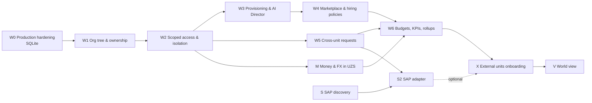

# SAG AI WORLD — Implementation plan

Status: **revised with the owner's decisions of 2026-10-30, awaiting review.** No BusinessUnit work starts
before W0 is complete and these documents are approved. Each phase ends with its acceptance criteria met, typecheck
+ all web and server tests + production build green, stress runs where relevant, a report in `docs/reports/`,
and [IMPLEMENTATION_PLAN.md](IMPLEMENTATION_PLAN.md) updated. Tests that were not run are listed in the report.

Design: [architecture](SAG_WORLD_ARCHITECTURE.md) · [data model](SAG_WORLD_DATA_MODEL.md) ·
[security model](SAG_WORLD_SECURITY_MODEL.md).

## Owner decisions applied (2026-10-30)

SQLite stays (no PostgreSQL phase); business types SAG_BRANCH / INDEPENDENT_DEALER / SUBSIDIARY; hierarchy
GROUP → REGION → UNIT → DEPARTMENT → EMPLOYEE/AGENT; SAP is the ERP target, discovery first; reporting currency
UZS with integer money and stored FX; hiring policies AUTO / APPROVAL (default) / RESTRICTED.

## Phase A — stabilisation (done)

| Test | Root cause | Fix |
|---|---|---|
| `people.test.ts` (1–2, 3, 4, 15), `auth.test.ts` role permissions — timed out at 5 s under parallel load | real scrypt (N=2^14) for every created user and login made CPU time decide the outcome | `setHashCostForTests()` in `lib/passwords.ts`, called from `test/setup.ts`; production parameters unchanged; verification reads parameters from the hash; new test covers a production-parameter hash |
| `schedule.test.ts` "Run now" — second click returned 200 | real bug: dedupe keyed on the wall-clock second | `runNow()` refuses while the previous run's task is open, in one write transaction |

Verified: 24/24 parallel-stress runs (4 concurrent suites × 6), server 118/118, web 39/39, typecheck and build
green (commit `e15aa50` / rewritten on GitHub as `b46dfab`). Known remaining timing assumption:
`runtime.test.ts` waits 30 ms for a settle timer — converted to fake timers in W0.3.

## Phase overview

S (SAP discovery) is mostly questions for SAG's SAP owner and can start now in parallel; it changes no code.

---

## W0 — Production hardening (implemented 2026-10-30, awaiting owner actions)

Status: implemented in the working tree and verified by tests — see
[W0_PRODUCTION_HARDENING_REPORT.md](W0_PRODUCTION_HARDENING_REPORT.md) for what was done, how it was tested and what
is still open. Not committed or deployed. Production readiness is **not** claimed: credential rotation and a real
off-site backup upload + restore are still outstanding.

| Plan item (below) | Status |
|---|---|
| W0.1 secrets | ⏳ owner actions (rotation checklist, GitHub Support); history on GitHub already clean |
| W0.2 data isolation | ✅ tasks (AI + human), agent chats, SSE, run records, tool payloads, approvals, connector log, stats, knowledge, memory, agent profiles |
| W0.3 reliable execution | ✅ heartbeat leases, `lease_epoch` fencing, execution records (`worker_id`, `lease_epoch`, `end_reason`), write-action idempotency, `unknown` for interrupted actions |
| W0.4 deployment/queue recovery | ✅ graceful stop releases leases; startup recovery via `worker_heartbeats`; attempts limit on crash loops; `/api/ready` |
| W0.5 proxy/rate limits | ✅ `TRUSTED_PROXIES`; DB-backed per-account backoff + per-IP ceiling |
| W0.6 backup/restore | ✅ code + tests + runbook · ⏳ not operational until storage is configured and a real restore drill passes |
| W0.7 readiness review | 🟡 see report §8 (CSRF/Origin, scrypt upgrade, admin-password log, Render env vars open) |
| W0.8 verification | ✅ see report §5 |

Original plan text follows (kept for reference).

Order: W0.1 user actions start immediately; W0.3 + W0.4 together (same code); then W0.2, W0.5, W0.6, W0.7;
W0.8 runs after each step. Every item: regression tests, typecheck, all tests, build.

### W0.1 Secrets and credential security

Findings (no values printed):

| Where | What | State |
|---|---|---|
| GitHub `main` (rewritten by someone with push access between 13:51 and 14:15 on 2026-10-30) | 21 commits scanned for `.env*`/`*.db` files, `KEY=value` assignments and Gemini/Telegram token patterns | **clean** |
| GitHub object store | old commit `d3605b2` (live `.env.example` values + `data/sag.db`) | **still retrievable by SHA** via the GitHub API |
| This computer, local `main` | the pre-rewrite history including `d3605b2` | present; diverged from GitHub (ahead 4 / behind 6, identical files except two new scripts) |
| Exposed in `d3605b2` | Gemini API key, Telegram bot token, admin password; `data/sag.db` with employee password hashes (scrypt N=2^14), hashed session tokens, audit and Telegram logs | **compromised until rotated** — removal from the latest tree or history does not make them safe |

Credential rotation checklist (owner actions, nothing is revoked by Claude without explicit authorisation):

1. **Telegram bot token** — @BotFather → `/revoke` → new token → local `.env` and Render env
   `TELEGRAM_BOT_TOKEN` → restart → `/status` in the group.
2. **Gemini API key** — Google AI Studio → API keys → delete the exposed key → create a new one, restricted to the
   Generative Language API → `.env` + Render `GEMINI_API_KEY`.
3. **Admin password** — change it in the app (Account → password); `ADMIN_PASSWORD` is only used on an empty DB,
   so changing the env var alone does nothing on an existing DB.
4. **Employee passwords** whose hashes were in the dev DB — force a reset for every account that exists in both
   the dev DB copy and production (or all accounts, if unsure); invalidate all sessions (one SQL statement,
   provided as a script in W0.1).
5. **Telegram group** — review members; the group id is not a secret but the leaked logs list who used the bot.
6. **SECRETS_KEY / Google / Slack / Notion** — not set yet, nothing to rotate; set fresh values only in env.
7. **GitHub** — open a GitHub Support request to remove cached views and dangling objects of the rewritten history
   (`d3605b2`); check repository collaborators, deploy keys and Actions secrets.
8. **Every working copy** — see "Git synchronisation" below. Never push from a clone that still has the old
   history: it would re-upload the secrets.

Full checklist with a status column: [CREDENTIAL_ROTATION.md](CREDENTIAL_ROTATION.md).

#### Git synchronisation

Record of this computer (`D:\SAG\SAG AI World v2`), done 2026-10-30 with the owner's explicit approval:

| Step | Result |
|---|---|
| Branch / working tree inspected | `main`, six modified documentation files, nothing untracked |
| Old commit SHA recorded | `1018634` (old local `main`; recoverable through the reflog until it expires) |
| Local work compared with the cleaned history | file tree of old `main` identical to `origin/main~2`; the two newer GitHub commits only add `scripts/auto-pull.ps1` and `scripts/register-auto-pull.ps1` — no unique local work |
| Documentation changes preserved | `git stash`, restored with `git stash pop` after the reset (no conflicts); all six files verified |
| Synchronised | `git reset --hard origin/main` (local only), documentation committed as `6a50866` on `main`, pushed as a fast-forward (`8ae696f..6a50866`); no force-push |
| Old history on GitHub | verified absent: `d3605b2`, `b4462c7`, `e15aa50`, `1018634` are not ancestors of `origin/main`; no local branch contains `d3605b2` |

Deviation from the procedure below (the procedure was confirmed after this sync): the documentation was restored
onto `main` directly rather than a separate review branch, and the stash was consumed rather than kept as a
second backup.

Procedure for any other working copy and for future synchronisations:
1. `git status`, `git branch --show-current`, record `git rev-parse HEAD`.
2. Back up uncommitted work recoverably: `git stash push -m "pre-sync <date>"` **and** a patch file
   (`git diff > ../pre-sync-<date>.patch`) outside the repository.
3. `git fetch origin`; compare `git log --oneline --left-right HEAD...origin/main` and `git diff HEAD origin/main`.
4. Unique local commits → re-create them on a new branch from `origin/main` (cherry-pick only commits checked to
   contain no secret). Otherwise move to `origin/main` **only after the owner approves the reset**.
5. Restore uncommitted work on a separate branch (`git switch -c sync/<date> origin/main`, `git stash apply`),
   review every diff, commit, then merge after review.
6. Never push the old history; never force-push without explicit approval.

Auto-pull: the Claude scheduled task `sag-ai-world-auto-pull` only fetches and fast-forwards; it never resets,
rebases, stashes or pushes, and skips on uncommitted changes or diverged history. Interval: every 30
minutes (approved by the owner 2026-10-30). Note: `scripts/auto-pull.ps1` in the repository (added from the other computer)
**does** stash and rebase; it does not meet these rules and should be aligned or retired by its owner.

Repository changes in W0.1:
- `scripts/scan-secrets.mjs` (no dependency): scans tracked files and staged changes for secret assignments, token
  patterns and database files; runs in `npm test` and as an optional `pre-commit` hook (`npm run hooks:install`).
- `.gitignore` re-verified (`data/`, `.env`, `.env.*` except `.env.example`, `*.db*`); a test asserts
  `.env.example` contains no non-empty secret values.
- `docs/SECURITY_INCIDENT_2026-10-30.md`: timeline, impact, rotation status, collaborator instructions.

Acceptance: scanner finds a planted fake token in a test fixture repo and none in the real tree; checklist items
1–4 confirmed done by the owner (recorded in the report); local `main` equals `origin/main`.

### W0.2 Data isolation and authorisation (user level, before units)

Inventory of every access path (routes, SSE, agent tools, domain queries) for: agent conversations, AI events,
tasks/subtasks (AI and human), employee profiles, knowledge, connector credentials and results, notifications,
calendar, reports/stats, approvals, memory. Fixes:

| Path | Today | After |
|---|---|---|
Access model **confirmed by the owner on 2026-10-30**: [security model §3.5](SAG_WORLD_SECURITY_MODEL.md#35-confirmed-task-access-model-owner-2026-10-30).

| Path | Today | After |
|---|---|---|
| AI and human tasks (`canSeeTask`, `visibleTaskSql`, lists, detail, deliverables, comments) | AI tasks visible to every `tasks:read` holder | §3.5 levels for both kinds: creator (+ subtree progress), assignee (+ parent context only), department head, unit director (`director` today); `tasks:read_all` evaluated within the unit |
| `GET /api/agents/:id/chat` | all users' chat with the agent | own conversation; others only with `agent_chat:read_others` (audited) |
| `GET /api/events` (SSE) | every AI event to everyone | ids/status only for tasks the user may see; detail fields need `ai_runs:read` / `tool_io:read`; stream closed on logout/deactivation |
| Run records, prompts, stage history | via task detail to any viewer | `ai_runs:read` |
| Approvals list / detail | all payloads to `tasks:read` | approvers and participants see the action; the payload needs `tool_io:read` or being the approver |
| Connector activity (`/api/connectors/activity`) | every agent's tool inputs/outputs to `tasks:read` | metadata for `brain:manage` and participants; payloads only with `tool_io:read`; secrets never |
| Knowledge list/search, memory | company-wide | own department + company-wide documents; everything with `brain:manage` |
| Stats (`/api/stats`) | company usage and cost to `tasks:read` | computed over the caller's visible tasks; cost needs `budget:read` (director today) |
| Calendar (routines, scheduled tasks) | to verify in the inventory | same scope as tasks |
| Employee profiles | existing person rules | unchanged; regression-tested |
| Notifications | addressee only | unchanged; regression-tested |
| Agent tools | to verify | same domain checks with the agent actor |

New permissions: `agent_chat:read_others`, `ai_runs:read`, `tool_io:read`, `budget:read` (seeded; defaults per
§3.5). Existing roles keep their current reach except where this table narrows it.

Tests, one per access level × path: creator, assignee (parent context but not parent comments or siblings),
department head (own vs. other department), director (whole unit), viewer, employee of another department, admin;
plus: another user's conversation unreachable; SSE never carries another department's task detail; tool payloads
hidden without `tool_io:read`; the connector log never contains secrets; stats totals equal the sum over visible
tasks.

### W0.3 Reliable agent execution

Design (SQLite, single writer; also correct with two worker processes on one host):

- **Fencing epoch**: `tasks.lease_epoch` increments on every claim; the runner holds `(task_id, epoch)`. Every
  runner write (`stage`, progress, deliverable, result, status change, subtasks, messages) is a guarded statement
  `… WHERE id = ? AND lease_epoch = ? AND status = 'IN_PROGRESS'`; zero rows changed ⇒ the run has lost
  ownership and stops without side effects.
- **Heartbeat**: short lease (default 90 s) renewed every 30 s by an atomic `UPDATE … SET lease_until = ? WHERE
  id = ? AND lease_epoch = ? AND lease_owner = ?`; a failed renewal aborts the run's `AbortController`. The
  per-task `maxDurationMs` limit stays the upper bound.
- **Execution record**: `agent_runs` gets `attempt`, `lease_epoch`, `worker_id`, `heartbeat_at`, `end_reason`
  (`succeeded`, `failed_retryable`, `failed_final`, `lost_lease`, `shutdown`, `cancelled`, `limit`).
- **Idempotent side effects**: deliverables unique per `(task_id, lease_epoch, title)`; approval requests unique
  per `(task_id, tool, args hash)` while pending; approved write tools keep the atomic claim and move
  `running → succeeded/failed`, and a crash mid-call leaves `unknown` that a person resolves (never auto-retried).
  Lease renewal alone is not treated as exactly-once: it only bounds overlap, the guards make overlap harmless.
- **Failure classes**: retryable (rate limit, timeout, network, 5xx — backoff inside the attempt, then re-queue
  with `attempts + 1`), final (auth/config, limit exceeded, validation, cancelled — FAILED with reason),
  lost lease/shutdown (no attempt consumed).

Tests: run longer than the lease with heartbeats (no second execution); heartbeat stops (simulated crash) →
recovered after expiry, old run's late writes rejected; two runners on one DB claiming concurrently → each task
once; retryable vs final classification; interrupted approved tool → `unknown`; settle timer via fake timers.

### W0.4 Deployment and queue recovery

Cause of the 15-minute stall: `runner.stop()` aborts runs but leaves their tasks `IN_PROGRESS` with a 15-minute
lease; `claimNextTask` serves one task per agent, so the agent's whole queue waits for `recoverExpiredLeases`.

- Graceful stop (SIGTERM/SIGINT): stop claiming → abort runs → release own leases in one transaction (back to
  `QUEUED`, attempt not consumed, run `end_reason = shutdown`) → wait for runs to settle (bounded, 10 s) → close
  HTTP and DB; idempotent; `unhandledRejection`/`uncaughtException` logged then the same path.
- Startup: `worker_heartbeats` row per process; tasks held by workers whose heartbeat is stale are re-queued
  immediately (short lease covers a crashed process); agent statuses stuck in THINKING/WORKING reset.
- Health: `/api/health` (liveness) and `/api/ready` (DB writable, migrations applied, runner alive, queue lag,
  last backup age, Telegram state).
- Routine run + its task in one transaction.
- `docs/DEPLOY.md`: worker lifecycle, shutdown, recovery, health checks, single-writer constraint.

Tests: SIGTERM mid-run → task QUEUED immediately and picked up after restart within one poll; crash (no graceful
stop) → recovered within the short lease; no task runs twice across restart.

### W0.5 Proxy and rate-limit security

- Replace `TRUST_PROXY=true` with `TRUSTED_PROXIES` (hop count or CIDR list) passed to Fastify; default: trust
  nothing. Render: one hop (its load balancer).
- DB-backed `login_throttle`: per-account exponential backoff and temporary lock after N failures (account owner
  notified), per-IP limit on the trusted IP; pruning job.
- Tests: direct request (no header) → socket IP; trusted proxy → correct client IP; forged `X-Forwarded-For`
  from an untrusted peer → ignored; forged left-most entries behind a trusted proxy → ignored; rotating forged IPs
  cannot exceed the per-account limit.

### W0.6 Database backup and recovery

- Job in the server: `VACUUM INTO` snapshot → `PRAGMA integrity_check` on the snapshot → gzip → AES-256-GCM with
  `BACKUP_KEY` (separate from `SECRETS_KEY`, key id in the header) → upload to **owner-chosen S3-compatible
  storage** (bucket, region, credentials in env) → manifest (sha256, bytes, schema version, row counts) →
  `backup_runs` row.
- Frequency configurable (default hourly), retention (default 48 hourly, 30 daily, 12 monthly), pruning.
- Verification: after upload, download → decrypt → open read-only → integrity check → compare row counts; a
  backup is "verified" only after this restore test succeeds; weekly full restore drill into a scratch directory
  with a smoke test of the app against it.
- `npm run backup:restore -- --key <object> --to <path>` and a documented restore runbook.
- Targets: **RPO ≤ 1 h** (hourly; 15 min possible), **RTO ≤ 30 min** (download + decrypt + swap file + restart),
  to be confirmed by a timed drill.
- No upload happens until the owner configures storage; nothing goes to a service the owner has not chosen.
- Pre-migration automatic backup in the migration runner.

### W0.7 Production deployment readiness review

Deliverable: a checklist in the W0 report with pass/fail per item — environment variables (required in
production, refused if missing: `COOKIE_SECURE`, `PUBLIC_URL`, `ADMIN_PASSWORD` on first boot, `SECRETS_KEY` when
connectors are on, `BACKUP_*`, `TRUSTED_PROXIES`), sessions (idle timeout, `__Host-` cookie, Origin check),
CORS/proxy, background workers, logging (correlation ids), error reporting (log-based alerts by default; an
external service only with approval), migrations and rollback, backup/restore, resource limits (request body
sizes, SSE connections per user, platform daily AI cost ceiling, per-task limits), password hashing upgrade
(N=2^17 with `maxmem`, rehash on login).

SQLite review (decision 1): the data layer is synchronous `node:sqlite` — **26 modules, ~360 call sites** use
`db.get/all/run/tx`. This is compatible with keeping SQLite and needs no refactor; the constraints it implies are
documented (single writer process, short transactions, no long queries on the event loop, vertical scaling).

### W0.8 Verification and documents

After each step: regression tests, typecheck, all web and server tests, production build, parallel stress runs
for W0.3/W0.4/W0.5. Update IMPLEMENTATION_PLAN.md, this plan, the security model; write
`docs/W0_PRODUCTION_HARDENING_REPORT.md` listing what was tested and what was not (e.g. real Render deploy,
real S3 upload if storage is not configured yet). **No production-readiness claim until every blocker in
security model §8 is resolved and verified.**

---

## Sprint "W0 completion + W1 foundation" (2026-10-30) — status

[Report](reports/2026-10-30-w0-completion-w1-foundation.md). Not committed / not deployed at the time of writing.

| Item | Status |
|---|---|
| W0: CSRF/Origin, secrets in logs, routine atomicity, stress root cause, reliability re-check | ✅ |
| W1: org tree, ownership, import, directors, AI Directors (from the store import) | ✅ |
| W1: unit functions, unit budgets, unit knowledge bases, unit connector installations, agreements READ/READ_WRITE + status | ✅ |
| W1: `unit_budgets` link to AI usage, FX rate table, per-unit connector credentials, UI for the new APIs | ⏳ pending |
| Real Gemini verification of unit AI Directors | ⏳ pending — local key rejected by Google |

## W2.1 Integration Hub Core (2026-10-30) — status

✅ registry, scoped instances, credential vault, ordered tool authorization, reliability, health runs, Integration
Hub API + HQ UI; ⏳ provider implementations (Anthropic, Bitrix24, SAP after discovery), sync jobs, per-instance OAuth
flows, unit-side UI — [report](reports/2026-10-30-w2-1-integration-hub-core.md). W2.2 waits for review.

## W1 — Organisation tree and ownership

`legal_entities`, `org_nodes` (GROUP/REGION/UNIT, business type, functions), triggers for tree rules,
`unit_policies` (hiring policy default APPROVAL), `unit_budgets`, `unit_memberships`; migration of the existing
organisation into `sag-group` → `toshkent` → `hq`; `business_unit_id` + composite FKs on all unit-owned tables;
read-only tree API.

Acceptance: migration on a copy of the dev DB (equal counts, all rows in `hq`, empty FK check); existing suite
passes unchanged; DB rejects cross-unit references and invalid tree shapes; one GROUP only.

## W2 — Scoped access and isolation

`UnitScope`; memberships, grants and business-type rules in the evaluator; data-sharing agreements; unit routes
`/api/units/:unitId/...` with aliases; scoped SSE; knowledge share-down and dealer publishing; per-unit connector
installations; SQLITE_BUSY retry in `db.tx`; concurrency tests.

Acceptance: leakage matrix green (incl. agreement on/off/expired); scope-required test; an INDEPENDENT_DEALER's data
unreachable from GROUP without an agreement; HQ behaviour unchanged.

## W3 — Provisioning and the AI Director

`provisionBusinessUnit` (one transaction, idempotent); function templates; human director membership or
invitation; automatic primary Director agent; unit orchestrator; `assertHuman`; units UI.

Acceptance: full-or-nothing provisioning (fault injection at each step); idempotent replay; human-only operations
refuse agent/system actors; director plans only inside its unit.

## W4 — Agent marketplace and hiring policies

Templates + approved versions; catalog of ten templates; `request_hire` tool (not offered under RESTRICTED or to
non-directors); validator (template approved, permission, max agents, budget in UZS, provider/model, token limits,
tools); AUTO with pre-approved list, APPROVAL (default) with approval card, RESTRICTED human-only.

Acceptance: each policy × each failing check rejected with a recorded reason; validator re-runs at decision time;
no hire grants tools outside template ∩ unit installations; no second director; hired agents cannot hire.

## W5 — Cross-unit requests

`unit_requests`, events, routes, links; the five kinds with schemas; human accept where required; requester task
waits on the request; result summary is the only crossing content.

Acceptance: assignment to a branch is split internally while the sender sees only status/progress/summary;
routes refuse unlinked or unagreed targets; DB refuses tasks from the wrong units.

## M — Money and FX (UZS)

`currencies`, `fx_rates`, integer money columns (AI cost in USD micro-units, budgets and reports in UZS tiyin);
single BigInt conversion function with half-even rounding; CBU rate import (manual entry first, automated fetch
only after the owner approves the source); migration of REAL cost columns.

Acceptance: property tests for conversion (no float path), reproducible reports (rate id stored), original amounts
preserved, mixed-currency rollup in UZS.

## W6 — Budgets, KPIs and rollups

Budget gate in UZS; KPIs (agent values PROPOSED until confirmed); aggregate-only rollups honouring business-type
rules and agreements; group dashboard.

Acceptance: a unit at budget stops starting AI work and its director is notified; rollups never return raw rows;
dealer aggregates appear only with an agreement.

## S — SAP discovery, then S2 — SAP adapter

S: answer the questions in architecture §11 with SAG's SAP owner; obtain a sandbox; record the decisions.
S2 (only after S): ERP port + SAP adapter for the agreed read APIs, `erp_org_mappings`, credentials per unit,
writes only behind approval and idempotency keys. No mock pretending to be SAP in production code.

## X — External units onboarding

Invitations to people outside SAG; INDEPENDENT_DEALER and SUBSIDIARY defaults; agreements; per-unit Telegram groups
and connectors. Acceptance: pilot with one dealer and one branch; leakage matrix with their real roles; security
review before go-live.

## V — World view

Map/3D view of the org tree using `geo`, status, KPIs and activity; strictly a view over existing APIs.

## Removed

PostgreSQL migration phase (decision 1). If measured load ever exceeds the SQLite constraints in architecture
§10, the database question is reopened as a separate decision.

## Owner actions needed now

1. Review and carry out [CREDENTIAL_ROTATION.md](CREDENTIAL_ROTATION.md) (Telegram token, Gemini key, admin
   password, employee password resets, sessions). Claude revokes or changes nothing without explicit approval.
2. Review the git synchronisation record and procedure (W0.1).
3. Open the GitHub Support request for cached objects (or authorise preparing its text).
4. Review the W0.2 authorisation changes (model confirmed; implementation waits for this review).
5. ~~Approve the auto-pull interval~~ — done: every 30 minutes.
6. Choose backup storage (provider, bucket, region) and create credentials + `BACKUP_KEY` (put them in `.env` /
   Render env yourself; never in chat).
7. Answer architecture §13 questions Q1–Q5 and name the SAP contact.
