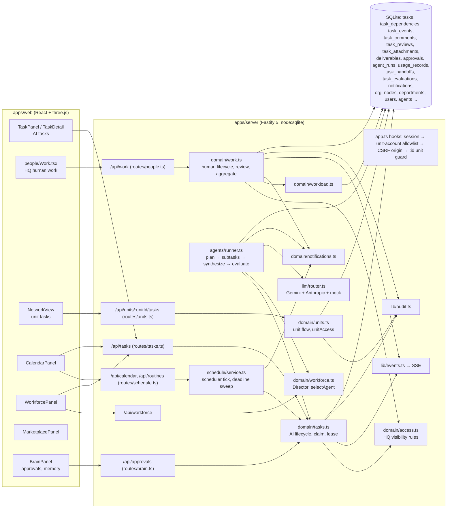
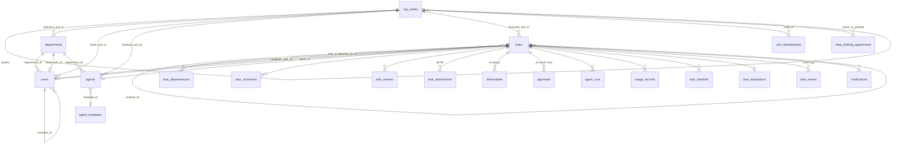
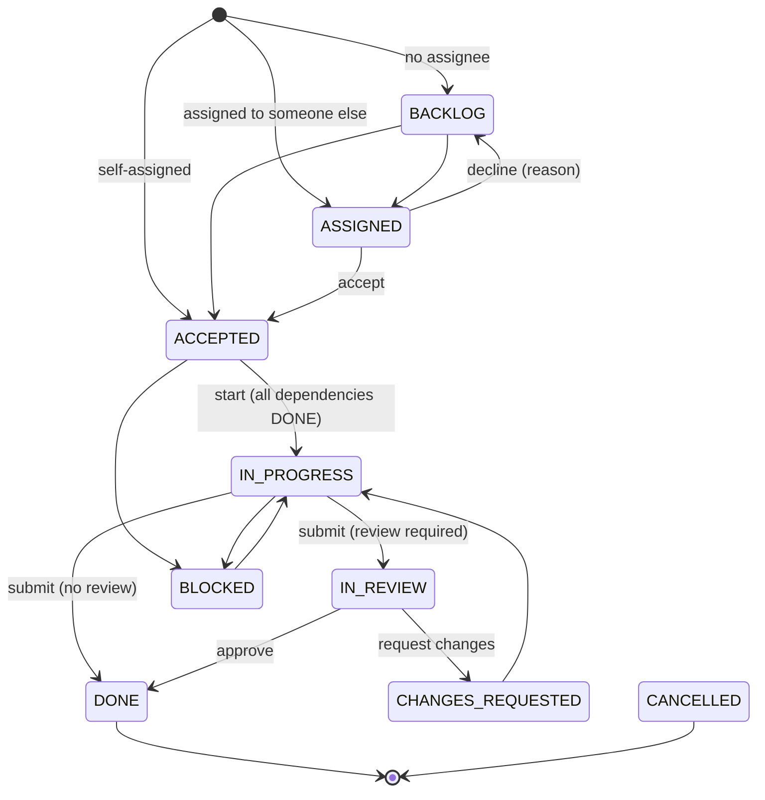
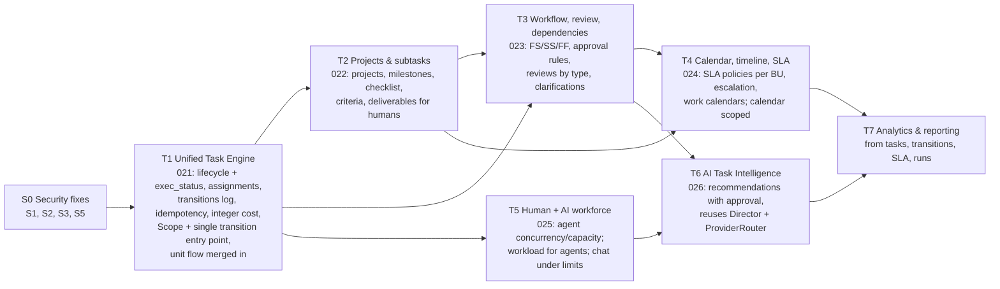

# T0 — Enterprise Work Management: architecture audit (2026-10-31)

**Base:** `f794a1b` (main, pushed).

**Scope:** read-only audit. No code, migration or data was changed for T0; this report is the only new file. Nothing is committed.

**Legend:**
- **[EXISTS]** means implemented and verified in code (file:line).
- **[PROPOSED]** means a design for T1–T7 that is not built.
- **[RISK]** means a finding that needs a fix.

Line numbers refer to the tree at `f794a1b`.

---

## 0. Summary

1. **[EXISTS] There is already one task table.**
   - Human and AI work share `tasks` (`007_people_workflow.sql:72-134`). They are told apart by `kind` ∈ `single | orchestrate | human`.
   - The spec's "unified task model" is partly done at the storage level. The domain layer is not unified.
2. **[EXISTS] Three workflows sit on that table:**

   | Workflow | Engine | Statuses |
   |---|---|---|
   | AI | `domain/tasks.ts` + `agents/runner.ts`, via `/api/tasks` | 9 AI statuses |
   | HQ human | `domain/work.ts`, via `/api/work` | 9 human statuses, validated transitions, review |
   | Store unit human | `domain/units.ts:602-659`, via `/api/units/:id/tasks` | Own simpler transition table |

   - The workflows share no lifecycle, assignment model or permission code.
   - Business status and AI execution status are mixed in one `status` column (13 values).
3. **[EXISTS] Assignment is one person or one agent per task:**
   - `assignee_user_id` (human), `agent_id` (AI) and `reviewer_user_id`.
   - There are no multiple assignees, no CONTRIBUTOR, no APPROVER, and no projects, checklists, acceptance criteria, SLA or milestones.
4. **[EXISTS] Strong parts worth keeping:**
   - lease and fencing execution (no duplicate runs);
   - validated human transitions with optimistic locking;
   - dependency cycle check;
   - parent progress aggregation;
   - workload engine (humans);
   - AI Director plan → staff → evaluate → revise;
   - provider router;
   - audit log;
   - SSE with per-user filtering;
   - unit triggers that stop cross-unit references.
5. **[RISK] Five security findings should be fixed before T1** (§11, S1–S5):
   - cross-unit task injection through `parentId`;
   - calendar and routines leak inside HQ;
   - unchecked `dependsOn`;
   - department knowledge bypass via agents;
   - unscoped delegation.

---

## 1. Current architecture [EXISTS]



The routes are thin and every rule lives in the domain layer. `requirePerm` is a flat `permissions.includes` check (`app.ts:92-101`). There are 166 HTTP routes in 13 route files.

---

## 2. Models and relationships [EXISTS]



### Tables used by the redesign

| Table (migration) | Fields that matter |
|---|---|
| `tasks` (001:135, rebuilt 007:72; columns from 003, 004, 005, 010:116, 012, 018) | **Status** CHECK has 13 values: 9 AI plus ASSIGNED, ACCEPTED, IN_REVIEW, CHANGES_REQUESTED.<br>**Kind:** `kind`.<br>**People:** `assignee_user_id`, `assigned_by`, `reviewer_user_id`.<br>**AI:** `agent_id`.<br>**Planning:** `priority` LOW..URGENT, `deadline`, `progress`, `estimate_hours`, `actual_hours` (REAL), `is_optional`, `weight`, `scheduled_for`.<br>**Execution:** lease_owner, lease_until, `lease_epoch`, attempts, max_attempts, `limits` JSON.<br>**Cost:** tokens, `cost_usd REAL`.<br>**Director:** `plan` JSON, `revision_of`.<br>**Unit:** `business_unit_id`.<br>**CHECKs:** a human task has no agent; only human tasks have an assignee (007:116-117).<br>**Unit triggers:** `trg_task_unit(_upd)` (010:148-169). |
| `task_dependencies` (001:169) | PK (task_id, depends_on_id), no self-dependency. **Single type (finish-to-start)**, **no unit trigger**. Cycles are checked in code (`tasks.ts:139`). |
| `task_events` (001:178; unit column 010:222) | Event log and SSE replay. Human history is read from it (`work.ts:591`). |
| `task_comments` (007:137) | kind comment, progress, result, decline, review or system. Author is `user_id` only (no agent author). |
| `task_reviews` (007:147) | APPROVED or CHANGES_REQUESTED by `reviewer_id` (human). |
| `task_attachments` (007:157) | File BLOB in the DB, 10 MB limit. |
| `deliverables` (001:202), `approvals` (001:213) | AI only: markdown output, result_review and tool approvals. |
| `task_handoffs`, `task_evaluations`, `ai_director_settings` (018) | Director orchestration and quality verdicts. |
| `agent_runs`, `usage_records` (001) | Per-call cost in **USD REAL**, mode live or mock, provider. |
| `notifications` (007:170) | Per user, `dedupe_key UNIQUE`. `sent_telegram_at` is never written. |
| `users` (007:6-19, 008, 010) | `capacity_hours_week` (0..80, default 40), `work_start`, `work_end`, timezone, `manager_id`, `workload_level` (cached). |
| `user_permissions` (007:60) | Grant scoped to one department, or global when NULL; `can_delegate`. |
| `org_nodes` (010:26) | GROUP → REGION → UNIT. HQ is the UNIT `hq`. `ownership_model` SAG_OWNED, FRANCHISE, INDEPENDENT or GROUP_OWNED. |
| `unit_memberships`, `data_sharing_agreements`, `unit_policies` (010) | Unit roles (director, manager, staff); cross-unit sharing by data class and level; hiring policy. |
| `unit_budgets`, `unit_budget_entries`, `currencies` (015); marketplace (017) | **Integer minor units (UZS)**. AI spend is never posted to these budgets. |
| `routines`, `routine_runs` (001, 005) | Recurring AI work. No unit column. |

No tables exist for projects, milestones, checklists, acceptance criteria, multiple assignments, SLA policies, work calendars or holidays, AI recommendations, or a status-transition history.

---

## 3. API endpoint inventory [EXISTS]

There are 166 routes in total. The task-related ones are below; the full list is in `apps/server/src/routes/*.ts`.

| Area | Endpoints | Guard |
|---|---|---|
| AI tasks (`routes/tasks.ts`) | GET/POST `/api/tasks`; GET/PATCH `/api/tasks/:id`; POST `:id/cancel`, `:id/retry`, `:id/reassign`, `:id/transition` | List: `tasks:read` + `visibleTaskSql`, AI rows only. Create: `ai_tasks:create`. Edit/cancel: creator or `tasks:manage`. Retry/reassign/transition: `tasks:manage`. Human rows return 409 `human_task`. |
| HQ human work (`routes/people.ts:205-265`) | GET/POST `/api/work`; GET/PATCH `/api/work/:id`; POST `:id/{assign,accept,decline,start,progress,submit,approve,request-changes,block,unblock,cancel,comments,attachments}`; GET `:id/attachments/:attId` | `requireUser` + domain rules (`canSeeTask`, `canManageTask`, `canAssignTo`) |
| Unit tasks (`routes/units.ts:110-126`) | GET/POST `/api/units/:unitId/tasks`; POST `…/:taskId/transition` | `unitAccess` |
| Calendar and routines (`routes/schedule.ts`) | GET `/api/calendar`; `/api/routines` (CRUD, pause, resume, run) | `tasks:read`; writes need `tasks:manage` |
| Approvals (`routes/brain.ts:160-171`) | GET `/api/approvals`; POST `/api/approvals/:id/decide` | `tasks:read` (filtered) / `tasks:manage` |
| Workforce (`routes/workforce.ts`) | GET `/api/workforce`; PUT `/api/workforce/director`; PUT `/api/agents/:id/provider` | brain:manage or users:manage / users:manage / agents:manage |
| Agents (`routes/agents.ts`, `routes/runtime.ts`) | CRUD, pause, resume, stop, archive, transfer; GET/POST `/api/agents/:id/chat`; GET `/api/system` | agents:read, agents:manage, agents:control, ai_tasks:create |
| Notifications and workload | GET `/api/notifications`, POST `/api/notifications/read`; GET/PUT `/api/settings/workload` | per user / `workload:configure` |
| Realtime | GET `/api/events` (SSE) | `tasks:read`, filtered per event by audience or `canSeeTask`; HQ only |
| Stats and audit | GET `/api/stats`; GET `/api/audit` | `visibleTaskSql` / `audit:read` |
| Marketplace | 16 routes under `/api/marketplace/*` | domain rules (admin, department heads) |

---

## 4. Current human task workflow [EXISTS]

### HQ (`domain/work.ts`, transitions in `HUMAN_TASK_TRANSITIONS`, `packages/shared/src/index.ts:50-61`)



Any open state can also go to CANCELLED or back to ASSIGNED (reassign).

How the engine behaves:
- **`move()` (`work.ts:72-93`)** validates each transition against the table. It then runs `UPDATE … WHERE status=?`, so a concurrent change returns 409. It also stamps timestamps, writes audit, and emits `task.status`.
- **Parent tasks** aggregate weighted progress from their required subtasks (`work.ts:111-149`). They move automatically to IN_REVIEW, DONE or BLOCKED, and the aggregation recurses up the tree.
- **Reviewer:**
  - Defaults to the creator; for a self-assigned task, to the manager.
  - Is never the assignee.
  - Review is required by default when work is assigned to someone else.
- **Deadline sweep** (scheduler tick, `notifications.ts:73`): one "deadline" notice 24 h before, then one "overdue" notice.
- **Workload** (`workload.ts:55`): effort-weighted load over a horizon against capacity, giving GREEN, YELLOW, ORANGE or RED. Rising to ORANGE or RED notifies the person and their manager.
- **Comments, attachments and history** come back in `workDetail`.

### Store unit (`units.ts:633` `HUMAN_FLOW`)

Transitions: ASSIGNED → ACCEPTED → IN_PROGRESS → IN_REVIEW → DONE or CHANGES_REQUESTED.

Compared with HQ, this flow has:
- **no** transaction and **no** `WHERE status=?` guard;
- **no** events, notifications, workload or reviewer fields;
- a department hard-coded to `dep_<unit>`.

---

## 5. Current AI task workflow [EXISTS]

```mermaid
sequenceDiagram
  participant U as User (ai_tasks:create)
  participant API as POST /api/tasks
  participant T as domain/tasks.ts
  participant S as scheduler / runner
  participant D as AI Director (orchestrate)
  participant A as Agent (single)
  participant L as ProviderRouter (Gemini/Claude/mock)
  U->>API: title, description, department or agent, limits, dependsOn, scheduledFor
  API->>T: createTask (pick least-loaded agent, or orchestrate on Director)
  T-->>S: QUEUED / WAITING_FOR_DEPENDENCY / BACKLOG
  S->>T: claimNextTask (atomic; ACTIVE agent, 1 task per agent, deps DONE; lease + epoch)
  alt kind = orchestrate
    S->>D: plan (zod + validatePlan, one correction retry)
    D->>T: subtasks + dependencies + handoffs; selectAgent per subtask; hire request when unstaffed
    T-->>S: children run as single tasks
    S->>D: evaluate each result (checks, then model) → ACCEPTED / NEEDS_REVISION (revision_of) / REJECTED / NEEDS_HUMAN_REVIEW
    S->>D: synthesize → deliverable
  else kind = single
    S->>A: build prompt (instructions, knowledge, memory)
    A->>L: call (checkLimits first; family budget; budget alert)
    L-->>A: answer (+ fallback provider), cost
  end
  S->>T: DONE, or WAITING_APPROVAL (result_review approval) when approval is required
  Note over S,T: lease 90 s, heartbeat renews it; dead worker → recovery; retries up to max_attempts
```

Weaknesses [EXISTS]:
- **Status writes are only partly central.** `claimNextTask`, `releaseLease`, `recoverExpiredLeases`, `reassignTask`, `cancelSubtasks`, `releaseDependents` and `agents.stopAgent` write `status` directly instead of going through `transitionTask`.
- **Chat bypasses execution controls.** `POST /api/agents/:id/chat` skips `checkLimits`, provider routing and provider bookkeeping.
- **Retry does not reset attempts.** `retryTask` leaves `attempts` as is.
- **Unstaffed subtasks stall the parent.** The parent waits until someone reassigns them manually.
- **New tasks always land in HQ.** Tasks created via `/api/tasks` are always `business_unit_id='hq'`, unless they inherit a unit from `parentId` (see S1).
- **Money is in two units.** AI cost is USD `REAL`; budgets are integer UZS minor units. Nothing links them.

---

## 6. Reusable today [EXISTS → reuse]

| Spec area | Existing piece to reuse |
|---|---|
| Unified Task Engine | `tasks` table (already shared); `transitionTask` and `move()` optimistic-lock pattern; transition tables in shared; `task_events` |
| Subtasks | `parent_id`, weighted aggregation `aggregate()` (`work.ts:111`), cascade cancel |
| Dependencies | `task_dependencies` + `assertNoCycle`, `releaseDependents`, `waiting_dependency` guard |
| Review / approval | `task_reviews`, `submitWork` / `reviewWork`, AI `approvals` (result_review), `task_evaluations` |
| Comments, attachments, activity | `task_comments`, `task_attachments`, `task_events`, `audit_logs` |
| AI execution | claim, lease, fencing, heartbeat, retries, `checkLimits`, family budget, `ProviderRouter`, mock labelling |
| AI planning | Director plan schema + `validatePlan`, `selectAgent`, `requestHireForAgent`, revisions |
| Workforce | `computeWorkload` (humans), `users.capacity_hours_week`, work hours and timezone, `workforceState` (agents) |
| Notifications | `notify()` with dedupe, deadline sweep, alerts |
| Scope and security | `org_nodes`, `unitAccess`, agreements, unit triggers, `:id` unit guard, CSRF origin check, audit redaction |
| Money | `currencies` + integer minor units (015) |
| Web | `people/Work.tsx` (board, detail, actions from `can{}`), `TaskDetail`, `WorkforcePanel`, `CalendarPanel`, `NotificationsBell` |

---

## 7. Missing functionality compared with the spec

| # | Spec item | Status |
|---|---|---|
| 1 | Assignment abstraction (HUMAN or AI_AGENT × OWNER, CONTRIBUTOR, REVIEWER, APPROVER, several per task) | Missing. Only single columns exist. |
| 2 | Projects (BU, owner, dates, status, priority, progress, milestones) | Missing. Orchestrate root tasks act as "AI projects". |
| 3 | Checklists, acceptance criteria, deliverables for humans | Missing. Deliverables are AI only. |
| 4 | Lifecycle BACKLOG → … → APPROVED → COMPLETED with separate execution status | Partial. Two lifecycles mixed in one column. APPROVED vs COMPLETED is not separate. |
| 5 | Actor-authorised transitions | Partial. HQ human work is validated with actor rules. AI transitions are validated but bypassed in 7 places. The unit flow is weak. |
| 6 | Dependency types FS, SS, FF (SF optional), visualisation, blocked explanations | Partial. FS only; the blocked reason is only `stage` text. |
| 7 | Configurable approval rules | Missing. Only a `requires_approval` flag and the default reviewer. |
| 8 | SLA policies per BU, escalation | Missing. Only deadline and overdue notices exist. |
| 9 | Work schedules / calendars | Partial. Per-user hours and timezone exist; no holidays, no unit calendar. |
| 10 | Calendar with deadlines and milestones | Partial. The calendar ignores `deadline` and shows no human tasks properly (and leaks, S2). |
| 11 | AI workload (concurrency, capacity) | Partial. The concurrency limit of 1 is hard-wired. Human workload exists. |
| 12 | AI Task Intelligence (recommend structure, assignees, estimates, conflicts, with explanation and approval) | Partial. The Director plans and staffs automatically; there is no recommend-and-approve mode and no estimates. |
| 13 | Analytics (cycle time, SLA compliance, revision rate, workload, AI cost) | Partial. `/api/stats` gives counts and cost. There is no transition history for cycle time. |
| 14 | Business Unit scope on every query | Partial. The HQ engine is hard-coded to `'hq'`; units use a separate engine. |
| 15 | Integer money for AI cost | Missing. Costs are USD REAL. |
| 16 | Duplicate task creation protection | Missing. There is no idempotency key on create. Duplicate execution is protected. |
| 17 | Agent-authored comments, human clarification requests | Missing. |
| 18 | Telegram delivery of human notifications | Missing. `sent_telegram_at` is unused. |

---

## 8. Database migration proposal [PROPOSED]

Ground rules:
- Each phase gets its own numbered migration, starting at 021.
- Every migration is additive or a CHECK-changing rebuild done the 007 way. A rebuild recreates every index and trigger and is covered by a fresh-vs-migrated schema test.
- No data is dropped.

| Migration | Phase | Content |
|---|---|---|
| **021_task_engine** | T1 | **Rebuild `tasks`** with the new lifecycle CHECK: BACKLOG, PLANNED, ASSIGNED, IN_PROGRESS, BLOCKED, IN_REVIEW, REVISION, APPROVED, COMPLETED, CANCELLED.<br>**New column `exec_status`** (NULL for human tasks): QUEUED, WAITING_DEPENDENCY, RUNNING, WAITING_APPROVAL, RETRY_WAIT, FAILED, SUCCEEDED, CANCELLED.<br>**New columns:** `project_id`, `idempotency_key` (unique per creator), `blocked_reason`.<br>**Data mapping:** see the table below. Recreate `trg_task_unit(_upd)` and all indexes. |
| | | **`task_assignments`**: id, task_id, business_unit_id, `assignee_type` HUMAN or AI_AGENT, user_id or agent_id (CHECK exactly one, matching type), `responsibility` OWNER, CONTRIBUTOR, REVIEWER or APPROVER, state (PENDING, ACCEPTED, DECLINED, REMOVED), assigned_by, timestamps.<br>**Constraints:** at most one active OWNER per task (partial unique index); a person or agent cannot be both OWNER and REVIEWER/APPROVER of one task (trigger); APPROVER must be HUMAN (CHECK); unit trigger.<br>**Backfill:** OWNER from `assignee_user_id` or `agent_id`, REVIEWER from `reviewer_user_id`. The old columns stay for one phase as mirrors kept in sync by the engine, then are dropped in T2. |
| | | **`task_transitions`**: task_id, from_status, to_status, from_exec, to_exec, actor_type (user, agent, system), actor_id, reason, at. Append-only and indexed. Backfilled from `task_events` where possible. This is the source for cycle time. |
| | | **Integer cost**: `tasks.cost_micro_usd`, `agent_runs.cost_micro_usd`, `usage_records.cost_micro_usd` as INTEGER, backfilled with `round(cost_usd*1e6)`. The REAL columns stay read-only until T7. *Decision needed: micro-USD (recommended, since per-call costs are fractions of a cent) or cents.* |
| **022_projects** | T2 | **`projects`**: id, business_unit_id, department_id, name, description, owner_user_id, status, priority, start_date, due_date, created_by, timestamps, idempotency_key.<br>**`project_milestones`**: project_id, title, due_date, status, completed_at.<br>**`task_checklist_items`**: task_id, text, done, done_by_type/id, position.<br>**`task_acceptance_criteria`**: task_id, text, met, checked_by, checked_at.<br>**Deliverables generalised:** add `submitted_by_type/id`, `version`, `status`, `attachment_id` to `deliverables`.<br>Unit triggers on all of them. |
| **023_workflow** | T3 | **`task_dependencies`**: add `type` FS, SS or FF (default FS) and `lag_minutes`, plus a unit trigger.<br>**`approval_rules`**: business_unit_id, department_id NULL, priority NULL, min_approvers, approver_role or approver_user_id, applies_to (task or project).<br>**`task_reviews`**: add `reviewer_type`, `round`, `responsibility`.<br>**`task_comments`**: add `author_type`, `agent_id`, and a `clarification` kind. |
| **024_sla_calendar** | T4 | **`sla_policies`**: business_unit_id, department_id NULL, priority, response_minutes, resolution_minutes, escalate_after_minutes, escalate_to_role. Integers.<br>**`task_sla`**: task_id, policy_id, response_due_at, resolution_due_at, breached_at, escalated_at, escalation_level.<br>**`work_calendars`** and **`calendar_holidays`**, per business unit. |
| **025_workforce** | T5 | **`agents.max_concurrency`** (default 1, which is today's behaviour) and **`agents.capacity_units`**. Optional `user_availability` (absences) only if the owner wants to record it; otherwise availability comes only from real data. |
| **026_ai_recommendations** | T6 | **`ai_recommendations`**: id, business_unit_id, kind (structure, decompose, assignee, estimate, dependency, conflict), input, output and explanation JSON, provider, model, mode (live or mock), cost_micro_usd, status (PROPOSED, ACCEPTED, REJECTED, EXPIRED), decided_by, decided_at, applied_task_ids. |
| T7 | T7 | No new tables expected. Indexes for analytics, e.g. `task_transitions(to_status, at)` and `tasks(business_unit_id, project_id, status)`. |

### Status mapping for 021

| Old status | New `status` | New `exec_status` (AI only) |
|---|---|---|
| BACKLOG | BACKLOG | — |
| QUEUED | ASSIGNED | QUEUED |
| WAITING_FOR_DEPENDENCY | PLANNED | WAITING_DEPENDENCY |
| IN_PROGRESS | IN_PROGRESS | RUNNING (AI) |
| WAITING_APPROVAL | IN_REVIEW | WAITING_APPROVAL |
| BLOCKED | BLOCKED | — |
| FAILED | BLOCKED | FAILED |
| DONE | COMPLETED | SUCCEEDED |
| CANCELLED | CANCELLED | CANCELLED |
| ASSIGNED | ASSIGNED | — |
| ACCEPTED | ASSIGNED, with the assignment state ACCEPTED | — |
| IN_REVIEW | IN_REVIEW | — |
| CHANGES_REQUESTED | REVISION | — |

---

## 9. Proposed API architecture [PROPOSED]

**One domain service, `domain/taskEngine/`, the only writer of `tasks.status` and `exec_status`:**
- `lifecycle.ts`: transition table and actor rules.
- `assignments.ts`
- `dependencies.ts`
- `review.ts`
- `scope.ts`: a `Scope` resolved once per request from user, unit, departments, agreements and grants.
- `transitionTask(ctx, scope, taskId, to, actor, reason)` is the single entry point. The runner, scheduler, unit flow and HQ work flow all call it, which removes the 7 direct UPDATEs.
- Every SQL query takes the `Scope` (`scopedTaskSql(scope)`), which generalises `visibleTaskSql` and removes the hard-coded `'hq'`.

**REST shape.** Existing routes stay as thin adapters until the web moves over, then they are removed.

| Resource | Endpoints |
|---|---|
| Projects | `GET/POST /api/projects`, `GET/PATCH /api/projects/:id`, `…/:id/milestones`, `…/:id/timeline` |
| Tasks (unified) | `GET /api/tasks?scope=&project=&assigneeType=&status=&view=` and `POST /api/tasks` (`Idempotency-Key` header). Task kind is a field, not a separate API. |
| Lifecycle | `POST /api/tasks/:id/transitions {to, reason}` plus intent endpoints kept for the UI: accept, decline, start, submit, approve, request-revision, block, unblock, complete, cancel. |
| Assignments | `GET/POST/DELETE /api/tasks/:id/assignments` |
| Dependencies | `GET/POST/DELETE /api/tasks/:id/dependencies`; `GET /api/tasks/:id/blockers` (explanation) |
| Content | `/api/tasks/:id/{checklist,criteria,deliverables,comments,attachments,reviews,activity}` |
| AI execution | `GET /api/tasks/:id/runs`; `POST /api/tasks/:id/retry` |
| Calendar and SLA | `GET /api/calendar` (scoped: deadlines, milestones, SLA due, routines); `/api/sla-policies` (CRUD per BU) |
| Workload | `GET /api/workload?unit=&department=` (humans and agents) |
| AI intelligence | `POST /api/ai/recommendations` (kind + input), `POST /api/ai/recommendations/:id/{accept,reject}`. Accepting applies the change through the engine in one transaction. |
| Analytics | `GET /api/analytics/tasks`, `GET /api/analytics/workload`, `GET /api/analytics/sla`, `GET /api/analytics/ai-cost` |

The same routes serve store units, with `?unit=` or `/api/units/:unitId/...` aliases resolving to the same `Scope`. There is no second unit engine.

---

## 10. Frontend module architecture [PROPOSED]

```
apps/web/src/work/                ← new feature folder (replaces people/Work.tsx and TaskPanel over time)
  api.ts                          typed client for the endpoints in §9
  ProjectList.tsx, ProjectDetail.tsx (milestones, progress, timeline/Gantt-lite)
  TaskBoard.tsx                   one board: filters by assignee type (human/AI), project, BU, department
  TaskDetail.tsx                  assignments, lifecycle actions (from server `can{}`), checklist, criteria,
                                  deliverables, reviews, dependencies (graph), AI runs/cost, activity
  DependencyGraph.tsx             dependency visualisation and "why blocked"
  CalendarView.tsx                deadlines, milestones, SLA due dates, routines (extends CalendarPanel)
  WorkloadView.tsx                people and agents from /api/workload (no invented numbers)
  AiPlanner.tsx                   natural-language objective → recommendations → approve/reject
  Analytics.tsx                   metrics from /api/analytics/*
  SlaSettings.tsx, ApprovalRules.tsx
```

The 3D world, `WorkforcePanel`, `MarketplacePanel` and `NetworkView` stay where they are and link into these modules.

Buttons keep coming from the server's `can{}` (the pattern in Work.tsx). The frontend never decides permissions.

---

## 11. Security and data-isolation risks

Ranked. All marked [V] were read in code; none were exploited.

| # | Risk | Evidence | Fix (when) |
|---|---|---|---|
| **S1** | **Cross-unit task injection.** An HQ user with `ai_tasks:create` sends `POST /api/tasks` with the `parentId` of another unit's AI task. The new task is created **inside that unit** (franchise included), and the call also reveals whether a given id exists. | `routes/tasks.ts:114` (`agentTaskOnly` checks only the kind), `domain/tasks.ts:197-205` (`row(parentId)`, unit taken from the parent). The `:id` guard in `app.ts:145-153` ignores body ids. | Check `canSeeTask` on parent and dependencies, and require the same unit as the caller's scope. **Before T1.** |
| **S2** | **Calendar and routines leak inside HQ.** Anyone with `tasks:read` (employee, viewer) sees the title and status of every top-level HQ task, human tasks included, and every routine. | `schedule/service.ts:291-305` (no `visibleTaskSql`, no kind filter), `routes/schedule.ts:26-29,71-77` | Apply `visibleTaskSql`; filter routines by department. **Before T1.** |
| **S3** | **Unchecked `dependsOn`.** It accepts any task id, including other units', which lets a caller probe existence and status. `task_dependencies` has no unit trigger. | `domain/tasks.ts:197-210`, `001_init.sql:169` | Check visibility and unit in code; add a unit trigger in 021. **Before T1.** |
| **S4** | **Department knowledge bypass via agents.** Chatting with, or giving a task to, an agent of another HQ department retrieves that department's documents and memory. | `routes/runtime.ts:66-69`, `agents/runner.ts:737-741` vs `routes/brain.ts:25,89-93` | Check the caller's departments for chat; record the requesting user's scope on the task. T1. |
| **S5** | **Delegation escalation.** A holder of `permissions:delegate` (director role) can grant any non-admin permission (`agents:manage`, `tasks:assign_any`, `agent_chat:read_others`) to any HQ user, without an own-scope check. | `domain/employees.ts:306-313` | Allow delegating only permissions you hold yourself, within your own scope. **Before T1.** |
| S6 | `headOf` is not filtered by unit, and `setDepartmentHead` does not check that the user is an HQ user. | `lib/auth.ts:57`, `employees.ts:341-348` | Filter by unit. T1 (scope work). |
| S7 | The `:id` unit guard is prefix-based, `:id` only; body ids rely on domain code. | `app.ts:40-49,145-153` | Replace it with `Scope` checks in the engine (T1); keep the guard as a backstop. |
| S8 | Approval decisions need only global `tasks:manage`, with no per-task scope. | `routes/brain.ts:160-171` | Check the APPROVER assignment or rule (T3). |
| S9 | A home-unit user without a membership row gets DETAIL access to the unit's tasks. | `units.ts:101-110,212` | Tighten in `unitAccess` (T1). |
| S10 | `company_memory`, `instructions`, `routines`, `chat_messages` have no unit column; GLOBAL instructions reach franchise agents. | `agents/prompt.ts:31-33` | Owner policy decision; add unit columns where needed (T1/T5). |
| S11 | No API or AI rate limiting; `COOKIE_SECURE` is off by default; sessions last 7 days with no idle timeout. | `package.json`, `config.ts:19` | Rate-limit task creation and AI chat (T1); production config. |
| S12 | The chat path skips `checkLimits` and provider bookkeeping, so its cost escapes limits. | `routes/runtime.ts:46-110` | Route chat through the same limits and accounting (T5). |

---

## 12. Implementation sequence



| Step | Depends on | Main risk | Notes |
|---|---|---|---|
| S0 | — | Small; about 4 focused fixes with tests | Recommended before T1, so the new engine starts from a clean base. Needs your approval as a separate step. |
| T1 | S0 | Highest: rebuilds `tasks` and touches the runner, scheduler, work and unit flows | All 266 server tests must keep passing. New tests: the transition matrix per actor, assignment rules, mapping of old rows, and idempotency. |
| T2 | T1 | Medium | Orchestrate root tasks can optionally be linked to a project. |
| T3 | T1, T2 | Medium | Dependency types change `releaseDependents` and the start guard. |
| T4 | T2, T3 | Medium | The deadline sweep becomes an SLA sweep, keeping dedupe. |
| T5 | T1 | Low to medium | Concurrency greater than 1 changes `claimNextTask`; it needs the reliability tests. |
| T6 | T3, T5 | Medium (AI cost, approval) | Mock runs are labelled; accepting a recommendation is a human action. |
| T7 | T1, T4 (T6 for AI cost) | Low | Read-only queries. |

### Decisions needed from the owner before T1

1. **Unit of integer AI cost**: micro-USD (recommended) or cents. Should AI spend also post to `unit_budgets` in UZS?
2. **The ACCEPTED status disappears** from the lifecycle. Acceptance moves to the assignment row. Is that acceptable?
3. **Start-to-Finish dependencies**: not implemented. Nothing in the current scheduling model needs it. Agree?
4. **Can an AI agent be REVIEWER** (advisory, like today's evaluations)? APPROVER stays human only.
5. **The store unit workflow merges into the same engine**, which means stores get review, events and notifications. Agree?
6. **S0 security fixes as a separate small step** before T1. Agree?
7. **The "W3.2" naming**: the HQ AI Director (`fff6bb1`) is kept unchanged; this roadmap uses T0–T7.
